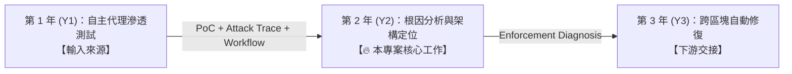

# 業務邏輯漏洞全生命週期防禦計畫（Logic Vulnerability Lifecycle）

本專案為三年期自主代理（Agentic AI）軟體安全整合計畫，專注於解決現代 Web/API 應用中難以被傳統靜態與動態工具捕捉的**業務邏輯漏洞（Business Logic Vulnerabilities / Broken Workflow / BOLA / IDOR）**。

---

## 📌 三年度研究主軸與分工

| 年度 | 研究主題 | 核心輸入 | 核心產出 |
| :--- | :--- | :--- | :--- |
| **Y1 (第一年)** | **應用層邏輯滲透測試與 PoC 生成** (Track A / 祐廷) | 原始專案與 API Spec | 狀態轉移圖譜、BOLA 攻擊向量、**成功的 Attack Trace 與 PoC** |
| **Y2 (第二年)** | **滲透後根因分析與架構強制機制定位** (Track B / 侑宸 / 本核心目錄) | Y1 Attack Trace + 正常 Workflow + 後端原始碼 | **專案層級強制機制診斷 (Enforcement Diagnosis)** |
| **Y3 (第三年)** | **跨層級多區塊智慧自動修復** (Track C / 羿君) | Y2 診斷報告 + 後端原始碼 | Multi-Hunk 跨檔案語意修補補丁與回歸驗證 |

---

## 📂 本計畫目錄結構與核心文件

* **003-三年計畫提出綱要-20261008.pdf**：2026/10/08 國科會三年計畫提出綱要簡報（S組 42 頁完整投影片，包含 DFD、9 大 CWE 威脅模型、CVE-2026-77999 與 CVE-2026-45810 案例與跨年度分工）。
* **[三年度計畫整合與架構設計.md](./三年度計畫整合與架構設計.md)**：三年期計畫總體架構、分工矩陣（祐廷、侑宸、羿君）與各階段推進藍圖。
* **[Y1-pentest-traces-context/](file:///c:/Users/LabStrix/Documents/GitHub/Youchen/Security/code-security-research/proposals/logic-vuln-lifecycle/Y1-pentest-traces-context/)**：第一年滲透成果之對接規範與輸入格式定義。
  * 包含方法論依據：[移動端後端滲透測試方法論.md](./Y1-pentest-traces-context/移動端後端滲透測試方法論.md)
* **[Y2-root-cause-localization/](file:///c:/Users/LabStrix/Documents/GitHub/Youchen/Security/code-security-research/proposals/logic-vuln-lifecycle/Y2-root-cause-localization/)**：**第二年研究核心工作區**（包含問題定義、三維評估設計與文獻對照）。
* **[Y3-repair-handover-specs/](file:///c:/Users/LabStrix/Documents/GitHub/Youchen/Security/code-security-research/proposals/logic-vuln-lifecycle/Y3-repair-handover-specs/)**：交接給第三年自動修復模組的診斷接口格式與評估協議。
