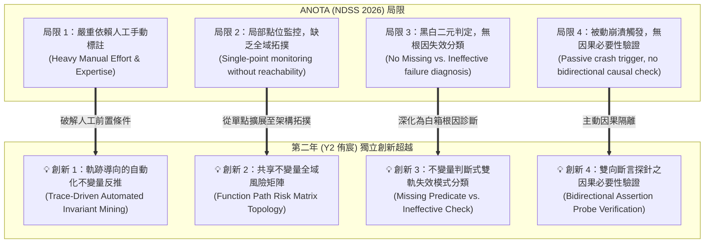

# ANOTA 對標局限與第二年（Y2）核心創新點

> **文獻對標**：*Anota: Identifying Business Logic Vulnerabilities via Annotation-Based Sanitization* (NDSS 2026)  
> **關聯文件**：[ANOTA_論文核心技術解讀.md](./ANOTA_論文核心技術解讀.md) ｜ [ANOTA_論文價值與參考借鑑.md](./ANOTA_論文價值與參考借鑑.md)  
> **研究邊界原則**：嚴格隔離第一年（Y1 祐廷：黑箱封包生成）與第三年（Y3 羿君：多點補丁修復），專注論述**第二年（Y2 侑宸：白箱根因定位與不變量診斷）**相較於 ANOTA 的獨立學術貢獻。

---

## 📌 執行摘要 (Executive Summary)

NDSS 2026 的 ANOTA 證明了「以語意政策（Annotations）作為 Sanitizer 能夠有效發掘業務邏輯漏洞」，但其系統架構具有嚴重的先決條件限制——**必須依賴經驗豐富的人類安全專家「預先、手動」在原始碼中標註安全政策**。

作者在論文第七章 Discussion（Section VII.C）中坦率指出：
> *"Annotations require manual effort to analyze the application... We view this framework as the necessary first step... enabling and supporting future research into reliable automation with LLMs."*

**第二年（Y2 侑宸）的研究正是承接並攻克 ANOTA 留下的核心學術空白**：我們不需要人類事先人工標註程式碼，而是以動態利用軌跡（Trace）為事實錨點，**全自動反推缺失的安全不變量、診斷判斷式失效模式，並擴展至全域拓撲風險矩陣**。

---

## 🔍 ANOTA 的四項固有局限性剖析

---

### 局限 1：沉重的人工先驗標註成本（Human-in-the-Loop Bottleneck）
* **ANOTA 現況**：要求安全分析師或開發者逐一閱讀原始碼，並預先在對應行號撰寫 `EXECUTION.BLOCK(...)` 或 `WATCH.ALLOW(...)`。
* **致命缺陷**：若審查員事先能精確知道哪一個物件、哪一個函式缺少何種約束，則該漏洞本質上已經被人工審查發掘了大半。在大型專案或複雜微服務中，全面人工標註在工程實務上成本極高且不切實際。

### 局限 2：單點插樁監控，缺乏全域呼叫鏈與拓撲可達性
* **ANOTA 現況**：監控器僅在「被標註的那一行/那個物件」生效。若同一業務物件在系統中有 5 個不同的進入點（Entrypoints）或控制器（Controllers），而人工只標註了其中 1 處，另外 4 處仍處於完全不防禦的狀態。
* **致命缺陷**：無法分析業務實體（Entity）在全系統控制流圖（CFG）與呼叫圖（Call Graph）中的共享關係，無法防範「修了 A 進入點卻遺漏 B 進入點」的典型旁路問題。

### 局限 3：被動式二元違規回報，無根因失效模式分類
* **ANOTA 現況**：Monitor 的唯一反應是拋出違規訊號給 Fuzzer。它只回答「有沒有違規（Violation = True/False）」，無法解析程式碼實作內部的失敗根因究竟是：
  * 「完全缺少檢查（Missing Predicate）」？
  * 還是「程式寫了檢查，但返回值未被採用或存入無效欄位（Ineffective Check）」？

### 局限 4：缺少「阻斷攻擊＋放行合法」的因果必要性驗證
* **ANOTA 現況**：ANOTA 是為了讓 Fuzzer 探索輸入，但無法主動向開發者證明該政策是否具備「因果必要性（Causal Necessity）」（即此限制會不會誤殺正常使用者的合法業務操作）。

---

## 💡 第二年（Y2 侑宸）的四大核心獨立創新點

為精準突顯 Y2 的學術貢獻，嚴格將範圍限定於「接收 Y1 軌跡 $\to$ 輸出根因與風險矩陣 $\to$ 交付 Y3 修補」，不涵蓋黑箱探索與多點補丁生成：

---

### 創新點 1：以攻擊軌跡為錨點的「全自動不變量反推」（攻克 ANOTA 未來工作）
* **技術內涵**：
  * Y2 **不需要人類事先人工標註**！
  * 接收 Y1 傳入的已觸發 exploit HTTP 封包與後端動態調用鏈（Trace）。
  * 結合靜態 AST 與呼叫上下文，以 LLM 進行反向因果推理，**自動合成出對應的安全不變量與約束條件**。
* **對標勝出點**：直接實現 ANOTA 論文在 Section VII.C 指名留給未來學術界的研究目標，將「人工手動政策宣告」躍升為「軌跡驅動的端到端全自動診斷」。

---

### 創新點 2：跨程序控制流之「共享不變量函式路徑風險矩陣」（拓撲擴展）
* **技術內涵**：
  * Y2 不僅定位單一漏洞點，而是建立**函式路徑風險矩陣（Function Path Risk Matrix）**。
  * 透過反向可達性分析（Backward Reachability Analysis），由推導出的不變量沿著呼叫圖逆流而上，搜尋全專案中**所有存取相同業務實體、或具備相同語意角色的其他 API 進入點**。
* **對標勝出點**：ANOTA 僅限於人工標記之單點；Y2 輸出全域拓撲風險地圖，精確列出哪些進入點「未實施該不變量（Un-enforced）」並標記嚴重性評級，為 Y3 的多點補丁合成提供直接導航。

---

### 創新點 3：不變量判斷式雙軌失效模式診斷（Missing vs. Ineffective）
* **技術內涵**：
  * Y2 深入分析目標程式碼中的邏輯結構，精確區分：
    1. **Missing Predicate（缺失型）**：業務檢查完全缺席（如 Nextcloud CVE-2026-45810），診斷結果指出應在哪個 Service/Domain 層插入檢查。
    2. **Ineffective Check（未採用型）**：檢查代碼已執行但資料流未正確約束分支（如 J2Store CVE-2026-77999 權限判定存入未讀取變數），診斷結果精確定位死代碼或邏輯旁路點。
* **對標勝出點**：超越 ANOTA 的二元崩潰回報，提供對開發者具備高度可解釋性的深層根因剖析。

---

### 創新點 4：非侵入式雙向斷言探針注入與因果驗證（Assertion Probing）
* **技術內涵**：
  * Y2 將自動推導出的約束轉換為 1 行斷言探針（Assertion Probe，語法繼承 ANOTA Table II 原語）。
  * **雙向重播驗證**：
    1. **攻擊重播（Attack Replay）**：注入探針後，原 Y1 Exploit 封包必須被此探針精確攔截（證明阻斷有效性）。
    2. **正常基線重播（Benign Baseline Replay）**：重播正常業務封包，必須順利通過該探針（證明無過度防護/無誤殺）。
* **對標勝出點**：在不進行複雜補丁合成（Y3 職責）的前提下，以最低成本客觀驗證不變量的因果必要性。

---

## 📋 總結對比矩陣 (Comparative Summary Matrix)

| 評估維度 | ANOTA (NDSS 2026) | INTENTFIX (ICSE 2026) | 本計畫第二年 (Y2 侑宸) |
| :--- | :--- | :--- | :--- |
| **主要定位** | 動態 Fuzzing Sanitizer | 靜態規格挖掘與單檔修復 | **白箱根因定位與因果不變量診斷** |
| **輸入依賴** | 原始碼 ＋ **人類專家手動註解** | 純原始碼（單一檔案） | 原始碼 ＋ **Y1 動態利用軌跡 (Trace)** |
| **自動化程度** | **半自動（需人工事前標註）** | 全自動（純靜態推測） | **全自動（動態事實導向反推）** |
| **拓撲視野** | 區域標註點 | 單一檔案 / 區域上下文 | **全域呼叫圖與跨程序路徑風險矩陣** |
| **失效分類** | 無（僅報 Violation） | 無（僅報 Presence Gap） | **雙軌分類（Missing vs. Ineffective）** |
| **因果驗證機制**| 被動等待 Fuzzer 觸發 | 生成自然語言攻擊說明（不可執行）| **可執行斷言探針雙向動態驗證** |
