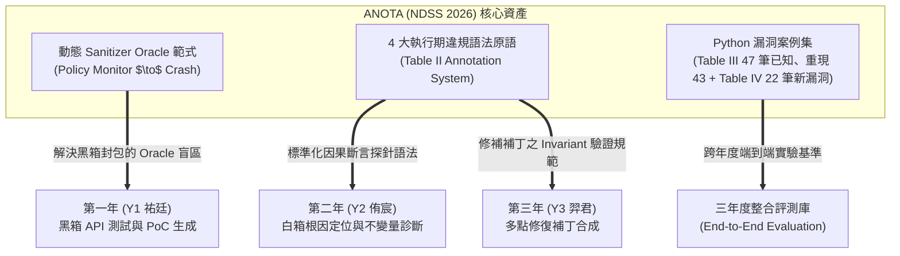

# ANOTA 論文價值與三年度計畫參考借鑑

> **文獻對標**：*Anota: Identifying Business Logic Vulnerabilities via Annotation-Based Sanitization* (NDSS 2026)  
> **關聯文件**：[ANOTA_論文核心技術解讀.md](./ANOTA_論文核心技術解讀.md) ｜ [ANOTA_對標局限與Y2核心創新點.md](./ANOTA_對標局限與Y2核心創新點.md)

---

## 📌 執行摘要 (Executive Summary)

NDSS 2026 的 ANOTA 論文在軟體安全界樹立了一個關鍵里程碑：**它正式確立了「消毒器（Sanitizer）可被拓展至業務邏輯漏洞領域」**。這篇論文並非單純的理論構想，而是以扎實的系統實作證明，只要能獲取結構化的業務意圖政策，動態測試（Fuzzing）即可高效攻破過去被視為黑箱盲區的邏輯漏洞。

對本「行動端應用後端邏輯漏洞生命週期防禦」三年期計畫而言，ANOTA 提供了豐富的跨年度架構啟發與現成工程資產。

---

## 🎯 對各年度子計畫的直接參考借鑑價值

---

### 一、對第一年（Y1 祐廷：黑箱 GUI 與 API 滲透測試）的借鑑

1. **突破邏輯漏洞的動態測試 Oracle 盲區（Test Oracle Problem）**：
   * **痛點**：Y1 在發送變異 HTTP 封包時，伺服器若未回傳 500 內部錯誤（通常回傳 200 OK 且附帶非授權資料），黑箱端極難判定是否成功越權。
   * **借鑑**：Y1 在建構灰箱或沙箱測試環境時，可參考 ANOTA 的 **Runtime Monitor 機制**，將後端敏感 API 設置為監聽點；一旦收到 Y1 的測試封包產生違規資料流或未授權物件存取，後端立即拋出信號中斷，使 Y1 的探索模組能瞬間捕捉到攻擊成功的軌跡（PoC Trace）。

2. **測試身分與 mutator 設計**：
   * ANOTA 在測試存取控制漏洞時，只給 fuzzer 低權限身分（未註冊訪客或一般使用者），其他情況才給高權限帳號；Web mutator 聚焦變異 cookie、query 參數、header 與 URL，並保留登入 session cookie 以測試登入後端點（Section V）。Y1 可參考此設定。
   * 注意：ANOTA 並未針對「不同憑證主體存取同一 Object ID」的 BOLA 變異策略提出主張；這是本計畫自己的設計，不應歸功於 ANOTA。

---

### 二、對第二年（Y2 侑宸：白箱根因定位與診斷）的借鑑

1. **借鑑成熟的「斷言探針形式化語法」（Assertion Probe Primitives）**：
   * **痛點**：Y2 在推導出缺失的不變量（Missing Invariant）後，需要將其轉化為可執行的探針（Assertion Probe）注入原始碼進行因果驗證，但若自創語法容易遭審查委員質疑通用性。
   * **借鑑**：Y2 可參考 ANOTA 的 Table II 語法作為因果探針的形式化表達：
     * 針對越權：採用 `EXECUTION.BLOCK(condition)` 形式（條件為真即違規，等同反轉的 assert）。論文範例為角色層級檢查（`user.type != 'admin'`）；BOLA 需要的物件擁有權謂詞必須自行定義。
     * 針對特權物件的非預期讀寫：採用 `WATCH.ALLOW/BLOCK(object, 'r'|'w'|'x')` 形式（WATCH 管的是程式對變數的存取權限，不是資料外洩）。
     * 針對資料外洩／敏感資料流：採用 `TAINT(var, sanitization=[...], Sink=[...])` 形式。
   * **措辭須保守**：ANOTA 原型**僅實作 Python**；JS/PHP 只有示意 Listing 與 VI.D 的移植構想，**未經驗證**。不可宣稱「ANOTA 驗證過跨語言遷移能力」。也要注意 Y2 標的以 Java/Spring 為主，Table II 語法的 Java 對應需自行定義。

2. **評估分類法參考**：
   * ANOTA 用 CWE Top 40 做的是**涵蓋範圍分析**（Table I：哪些 CWE 屬業務邏輯、ANOTA 支援哪些），並非作為評估實驗的對比基準；實際評估以 Table III/IV 的個別漏洞與 Table VII 的 35 個靶場漏洞計分。Y2 的 RQ1 若要按 CWE 類別報告，可引用 Table I 的業務邏輯分類作為依據。

---

### 三、對第三年（Y3 羿君：多點補丁修復）的借鑑

1. **修補正確性的客觀規格驗證（Repair Oracle）**：
   * 現有自動程式修復（APR）最大的問題是「過度修補（Over-fitting）」或「破壞正常業務功能」。
   * ANOTA 的註解政策本質上就是**最嚴謹的 Invariant 規格**。Y3 合成出的修補程式碼，可放回裝有 ANOTA Monitor 的環境中驗證：修復後是否能通過正常業務測試套件，且不再觸發 ANOTA 的 Policy Violation。

---

### 四、評測基準數據庫共享資產 (Benchmark Assets)

ANOTA 的評估資料分為三組，彼此獨立：
* **Table III（已知漏洞重現）**：47 個 Snyk 收錄的 Python 套件漏洞，重現 43 個。以 System Call 類（SSRF、path traversal、上傳、反序列化）為主，授權類（Object Access / Code Execution）僅約 8 筆。
* **Table IV（0-day）**：22 個新漏洞（17 CVE）。Home Assistant Core 在此組，其發現為 CWE-532 log 洩漏（Data Flow），**與權限模型或 Controller/Service 呼叫鏈無關**。授權類僅 ihatemoney 1 筆（CWE-732）。
* **Table VII（消融與 SOTA 比較）**：PyGoat、OWASP Vulnerable Flask App、DSVW、VAmPI 四個刻意留洞靶場中的 35 個漏洞。

對本計畫的可用性評估：
* **語言不符**：全部標的皆為 Python；Y2 以 Java/Spring 為主（MocGuard、IDORacle 路線），無法直接沿用，也無法直接拿 ANOTA 當 baseline 執行。
* **漏洞類型不符**：BOLA / missing-owner-check 在 ANOTA 資料中幾乎沒有代表；若要借用，只有 Table III 的少數 OA/CE 案例（如 indico CWE-639、Apache-Airflow CWE-862、MobSF、mlflow、calibre-web）可作為跨語言對照。
* **重現環境**：論文表示 Table III 每個應用都建了 Docker 容器，實作與評估腳本公開於 https://github.com/ANOTA-Sanitizer/ANOTA；各容器是否完整公開需實際檢查 repo 後確認。
