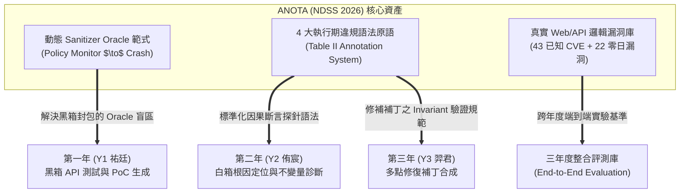

# ANOTA 論文價值與三年度計畫參考借鑑

> **文獻對標**：*Anota: Identifying Business Logic Vulnerabilities via Annotation-Based Sanitization* (NDSS 2026)  
> **關聯文件**：[ANOTA_論文核心技術解讀.md](./ANOTA_論文核心技術解讀.md) ｜ [ANOTA_對標局限與Y2核心創新點.md](./ANOTA_對標局限與Y2核心創新點.md)

---

## 📌 執行摘要 (Executive Summary)

NDSS 2026 的 ANOTA 論文在軟體安全界樹立了一個關鍵里程碑：**它正式確立了「消毒器（Sanitizer）可被拓展至業務邏輯漏洞領域」**。這篇論文並非單純的理論構想，而是以扎實的系統實作證明，只要能獲取結構化的業務意圖政策，動態測試（Fuzzing）即可高效攻破過去被視為黑箱盲區的邏輯漏洞。

對本「行動端應用後端邏輯漏洞生命週期防禦」三年期計畫而言，ANOTA 提供了豐富的跨年度架構啟發與現成工程資產。

---

## 🎯 對各年度子計畫的直接參考借鑑價值

---

### 一、對第一年（Y1 祐廷：黑箱 GUI 與 API 滲透測試）的借鑑

1. **突破邏輯漏洞的動態測試 Oracle 盲區（Test Oracle Problem）**：
   * **痛點**：Y1 在發送變異 HTTP 封包時，伺服器若未回傳 500 內部錯誤（通常回傳 200 OK 且附帶非授權資料），黑箱端極難判定是否成功越權。
   * **借鑑**：Y1 在建構灰箱或沙箱測試環境時，可參考 ANOTA 的 **Runtime Monitor 機制**，將後端敏感 API 設置為監聽點；一旦收到 Y1 的測試封包產生違規資料流或未授權物件存取，後端立即拋出信號中斷，使 Y1 的探索模組能瞬間捕捉到攻擊成功的軌跡（PoC Trace）。

2. **滲透測試 Payloads 的變異方向引導**：
   * ANOTA 指出 CWE-862（缺授權）與 CWE-863（授權不當）最容易在多角色、多資源切換時觸發。Y1 可借鑑其思路，重點針對「不同憑證主體存取同一 Object ID」進行封包變異設計。

---

### 二、對第二年（Y2 侑宸：白箱根因定位與診斷）的借鑑

1. **借鑑成熟的「斷言探針形式化語法」（Assertion Probe Primitives）**：
   * **痛點**：Y2 在推導出缺失的不變量（Missing Invariant）後，需要將其轉化為可執行的探針（Assertion Probe）注入原始碼進行因果驗證，但若自創語法容易遭審查委員質疑通用性。
   * **借鑑**：Y2 可**直接繼承 ANOTA 的 Table II 語法標準**作為因果探針的形式化表達：
     * 針對水平/垂直越權：採用 `EXECUTION.BLOCK(condition)` 形式。
     * 針對資料外洩：採用 `WATCH.ALLOW(object, 'r')` 形式。
     * 針對敏感資料流：採用 `TAINT(var, sink)` 形式。
   * 在論文與計畫書中可直接主張：*「本研究之診斷探針採用 NDSS 2026 ANOTA 驗證過之執行期違規語法原語，具備高度通用性與跨語言遷移能力。」*

2. **消融實驗與基準度量衡設計**：
   * ANOTA 在評估檢出能力時，以 CWE Top 40 中的業務邏輯漏洞清單作為橫向對比基準。Y2 在評估 RQ1（根因覆蓋率）時，可直接引用 ANOTA 的分類法，驗證系統在 9 大 CWE 類別上的定位能力。

---

### 三、對第三年（Y3 羿君：多點補丁修復）的借鑑

1. **修補正確性的客觀規格驗證（Repair Oracle）**：
   * 現有自動程式修復（APR）最大的問題是「過度修補（Over-fitting）」或「破壞正常業務功能」。
   * ANOTA 的註解政策本質上就是**最嚴謹的 Invariant 規格**。Y3 合成出的修補程式碼，可放回裝有 ANOTA Monitor 的環境中驗證：修復後是否能通過正常業務測試套件，且不再觸發 ANOTA 的 Policy Violation。

---

### 四、評測基準數據庫共享資產 (Benchmark Assets)

ANOTA 在 Home Assistant、PyGoat、OWASP Flask 等主流架構上復現了 43 個已知漏洞，並挖掘了 22 個全新零日漏洞（獲得 17 個 CVE）：
* **真實架構貼近性**：包含 Home Assistant（具備複雜的智慧家庭權限模型、多層 Controller/Service 呼叫鏈），與本計畫關注的現代 Web / 行動端微服務後端架構高度相符。
* **可重現實驗環境**：該論文公開的實驗標的均具備完整的 Docker 容器化重現環境，可直接納入本三年計畫的實證數據庫（Benchmark Suite）中。
