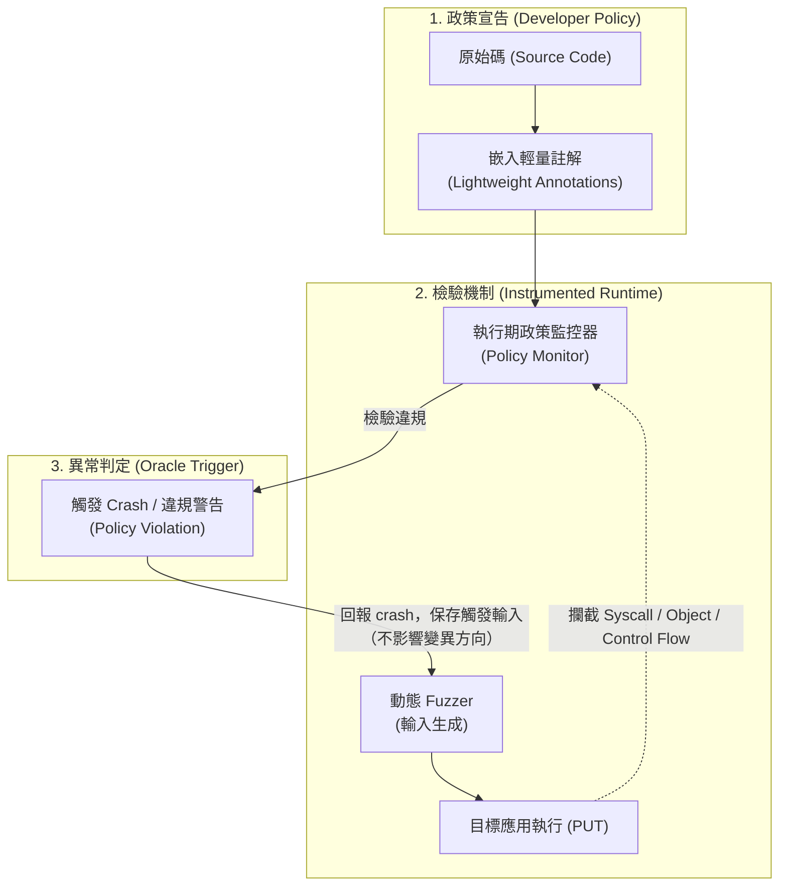

# ANOTA 論文核心技術解讀與架構剖析

> **論文原題**：*Anota: Identifying Business Logic Vulnerabilities via Annotation-Based Sanitization*  
> **發表會議**：Network and Distributed System Security Symposium (**NDSS 2026**)  
> **論文出處**：DOI: `10.14722/ndss.2026.240938` | 本地存檔：`code-security-research/2026-f938-paper.pdf`  
> **作者團隊**：Meng Wang (CISPA), Philipp Görz (CISPA), Joschua Schilling (CISPA), Keno Hassler (CISPA), Liwei Guo (UESTC), Thorsten Holz (MPI-SP), Ali Abbasi (CISPA)  
> **研究機構**：CISPA Helmholtz Center for Information Security, Max Planck Institute for Security and Privacy, 電子科技大學

---

## 📌 執行摘要 (Executive Summary)

模糊測試（Fuzzing）是目前發掘軟體漏洞最普及的動態分析技術，但其有效性高度依賴**消毒器（Sanitizer）**。在傳統記憶體安全領域，AddressSanitizer (ASan) 透過回報非法記憶體存取，將隱蔽缺陷轉化為即時的崩潰訊號（Crash Oracle）。然而，在**業務邏輯漏洞（Business Logic Vulnerabilities）**中，程式不違背語法規範、不產生記憶體崩潰，Fuzzer 無法辨識特定輸入是否觸發了越權或邏輯繞過（即 Test Oracle 難題）。現有啟發式靜態規則面對多變的業務語意往往過度脆弱或產生大量誤報。

發表於資安頂會 NDSS 2026 的 **ANOTA** 提出了一個創新的「人在迴路（Human-in-the-Loop）」消毒器架構。其核心遵循系統設計經典的**「機制與政策分離原則（Separating Policy from Mechanism）」**：
1. **政策層（Policy）**：提供直觀輕量化的**註解系統（Annotation System）**，讓開發者或分析師在原始碼中直接標記業務安全意圖。
2. **機制層（Mechanism）**：由語言無關的**執行期政策監控器（Runtime Policy Monitor）**攔截系統底層行為，當執行偏離註解政策時即向 Fuzzer 回報 Crash 訊號。

---

## 🎯 核心問題定義：CWE Top 40 中的業務邏輯盲區

論文針對 MITRE CWE Top 40 進行全景分析（Table I），〔註（2026-10-12 核對 cwe.mitre.org）：MITRE 無名為「Top 40」的正式榜單。Table I 的 40 項與 **2024 CWE Top 25 ＋ 2024 On the Cusp 15 項**逐一相同，但論文參考文獻 [22] 引用的是「Trends in Real-World CWEs: 2019 to 2023」，兩者不一致。詳見討論紀錄 ANOTA Q16〕將現有 Fuzzing Sanitizer 的盲區分為兩組：
* **未獲解決弱點（Unaddressed Weaknesses）**：目前完全沒有對應 Sanitizer。論文以授權與認證類為代表（如 **CWE-862** Missing Authorization、**CWE-863** Incorrect Authorization、**CWE-287** Improper Authentication、**CWE-269** Improper Privilege Management），另舉 **CWE-427** Uncontrolled Search Path Element 為例——Sanitizer 必須知道開發者預期的權限模型或檔案存取範圍才能判定。
* **狹隘解決弱點（Narrowly-Addressed Weaknesses）**：已有 Sanitizer，但**泛化能力有限**（並非「已充分解決」）。一類依賴語言特定啟發式（如 Atropos/PHUZZ 綁定 PHP 標準函式、Atropos 以副檔名判定惡意上傳、ODDFuzz 專攻 Java 反序列化）；另一類有嚴苛前置條件（如 EDEFuzz 需要可渲染的 Web 介面、FLOWFUZZ 需要完全相同的可重置執行環境——兩者皆針對 **CWE-200** 類資訊洩漏）。

論文的核心論點是：兩組弱點的共同成因都是「必須具備應用程式特定的業務上下文才能判定合法與否」，而自動化啟發式無法可靠推導這種上下文。

另外，SQLi (CWE-89)、Hard-coded Credentials (CWE-798)、CSRF (CWE-352) 被**刻意排除**在 ANOTA 範圍之外——理由是開發者一旦意識到問題，即可用標準做法（prepared statement、移除憑證、CSRF token）直接修補，標註反而多餘（Section VI.B）。

---

## 🛠️ ANOTA 註解語法體系 (Annotation System)

ANOTA 將業務邏輯偏差行為歸納為 4 大執行期異常型態，並提供直觀的註解語法（Table II）：

| 異常類別 | 核心意圖說明 | 註解語法範例 | 實際防護情境 |
| :--- | :--- | :--- | :--- |
| **System Call** | 限制特定檔案系統與行程呼叫 | `SYSCALL.BLOCK('execv', 'execve')` `SYSCALL.READ.BLOCK(PATH='/etc/')` `SYSCALL.EXECVE.ALLOW(PATH='/bin/ls')` | 防止目錄遍歷越界讀取、非預期系統命令調用 |
| **Data Flow** | 追蹤資料流傳播與脫敏 | `TAINT(pwd, sanitization=[hash], Sink=[print])` | 確保密碼、Token 必須經過雜湊脫敏後才能印出或回傳 |
| **Object Access** | 限制關鍵變數/函式的讀（r）、寫（w）、執行（x）權限；`WATCH.CON` 宣告執行時間應統計上為常數 | `WATCH.ALLOW(admin_data, 'r')` `WATCH.BLOCK(admin_api, 'x')` `WATCH.CON(passwd_cmp)` | 阻擋程式在非預期處讀寫特權變數；以 Dudect 統計檢測計時側信道 |
| **Code Execution** | 限制特定程式碼區域的執行條件（作用如「反轉的 assert」：條件為真即違規） | `EXECUTION.BLOCK(user.type != 'admin')` | 確保非管理員不可抵達特權執行區塊（垂直越權）。**註**：論文範例皆為角色層級檢查，未展示 BOLA 這類物件擁有權（`resource.owner == user`）案例 |
| **Clear** | 動態清除/重設局部作用域政策 | `CLEAR(...)` `SYSCALL.NETWORK.CLEAR()` | 在合法業務切換階段釋放特定限制 |

---

## ⚙️ 執行期監控器機制 (Runtime Policy Monitor)

原型實作約 5,500 行 Python / C / Rust，**僅支援 Python**（JavaScript、PHP 的 Listing 僅為示意，Section VI.D 只勾勒移植策略，未實作）。

1. **註解解析（Annotation Frontend）**：
   * 註解在語法上就是普通函式呼叫。修改後的 CPython 在 `CALL_FUNCTION` opcode 上掛 hook，**執行到註解呼叫時**才解析參數並轉成執行期政策（不是在程式載入時一次解析）。
2. **三種監控後端（Policy Monitor）**：
   * **純 Python 程式碼**：修改 CPython——在 `PyObject` 基底結構加上 taint 屬性並逐 opcode 傳播（Data Flow）；在 `LOAD_*` / `STORE_*` opcode 比對 watch list（Object Access，全域變數全域檢查、區域變數只在定義它的 stack frame 內檢查）。
   * **C/C++ 擴充模組**：提供修改版 LLVM DataFlowSanitizer pass 傳遞 taint；C 模組內的變數存取以 `ptrace` 讀寫斷點監控。
   * **系統呼叫**：以 Rust + Aya 實作的 eBPF 程式（約 3,000 行）掛在 `raw_syscalls:sys_enter` / `sys_exit`，監控整個行程及其子行程；`read` 等呼叫的路徑由對應 `openat` 的回傳 fd 回推。
3. **對接 Fuzzer**：
   * 偵測到違規時，monitor 送 signal 給直譯器，直譯器主動觸發 segmentation fault，讓 fuzzer 視為 crash。論文宣稱可接任何 fuzzer，但**實驗只使用 Atheris**；Web 應用另寫了 custom mutator（變異 cookie、query、header、URL），並內建反序列化與 code injection payload 字典。
4. **組合式偵測器範例**：TOCTOU 偵測 = syscall 監控（check-then-use 模式）＋ data flow（只對含敏感資料的檔案回報），用來展示框架的可擴充性。

---

## 📊 實驗設計與關鍵成效 (Evaluation & Results)

所有實驗皆為 **ANOTA + Atheris**（Python fuzzer），執行於 i9-13900K / 64 GB / Ubuntu 22.04。共五組實驗，**標的彼此不同，不可混為一談**：

| 實驗 | 標的 | 結果 |
| :--- | :--- | :--- |
| **(A) 已知漏洞重現**（Table III） | 從 Snyk 資料庫篩出的 47 個 Python 套件漏洞（langchain、label-studio、Apache-Airflow、mlflow、Transformers 等） | 重現 **43 / 47**；ID 給的是 CVE 或 **SNYK ID**（並非全部是 CVE） |
| **(B) 0-day 挖掘**（Table IV） | 60 個 GitHub Python 專案（>200 stars），含 4 個有 bug bounty（Superset、Airflow、ZenML、Calibre-Web）與 Home Assistant Core | 回報 **22** 個；20 個取得編號，其中 **17 個 CVE**、3 個為 Apache/GitHub/Microsoft 內部編號；另有 2 個誤報 |
| **(C) 消融與 SOTA 比較**（Table VII） | 35 個漏洞，來自 4 個刻意留洞的靶場：PyGoat、OWASP Vulnerable Flask App、DSVW、VAmPI（約 19,200 行） | ANOTA+Atheris 35/35；原生 Atheris 0/35；次佳 SonarQube 18、ZAP 17 |
| **(D) 使用者研究** | 11 位學生標註 6 個應用；10 位業界開發者訪談 | 66 個任務中 55 個成功（83.3%） |
| **(E) 效能** | pyperformance | 全變數 taint 約 10%、記錄全部 syscall 約 5% overhead |

### 漏洞類型分布（對本計畫很關鍵）
* **(A) 重現的 43 筆**：System Call 類（SSRF、path traversal、上傳、反序列化、code injection、XXE）約 27 筆為主體；Data Flow 約 9 筆；**Object Access 5 筆、Code Execution 3 筆**——授權類是少數。
* **(A) 未重現的 4 筆**中有 3 筆是 CWE-287 認證/授權類（vantage6 預設 SSH 設定、Superset 細粒度權限、ZenML 需多使用者互動前置條件），另 1 筆（nautobot）需特定組態才會觸發。
* **(B) 22 個 0-day**：Data Flow 12、System Call 9、**Object Access 1**（ihatemoney，CWE-732）、**Code Execution 0**。依 CWE：CWE-532 log 洩漏 6、CWE-94 code injection 5、CWE-367 TOCTOU 4、CWE-434 上傳 4、CWE-208 計時側信道 2、CWE-732 1。Home Assistant Core 的發現屬於 CWE-532（Data Flow），不是權限模型問題。
* **使用者研究**中失敗最多的題目（7/11 失敗）是 changedetection.io 的 Broken Access Control。

> 註：論文 Table III 的 ID 12 出現兩次，Table IV 下方的 CVE 清單中 CVE-2024-34524 重複列出（扣除後正好 17 個），屬排版瑕疵。

---

## ⚠️ 論文作者坦承的局限與未來方向 (Section VI.C 與 V-D1)

> 章節對照：Section VI 為 Discussion and Future Work（VI.C 為 Integrating LLMs，位於第 14 頁）；Section VII 為 Related Work。

在 VI.C 中，作者指出 ANOTA 面臨的根本局限：
1. **依賴昂貴的人工手動成本（Manual Effort）**：
   * 註解必須由深諳業務邏輯的專業人員手動審閱程式碼並撰寫，在大型複雜專案或仰賴第三方黑箱庫時，人工標註成本極高。
2. **專家知識依賴度高（Human Expertise Dependency）**：
   * 標註品質完全取決於審查員的經驗，若標註不完整或標註錯誤，Monitor 將無法檢出漏洞或產生反效果。
3. **作者展望：引入 LLM 進行政策自動化**：
   * 作者提出以 LLM 分析原始碼、半自動產生註解作為未來方向，同時指出幻覺與大型上下文需求是障礙，因此 LLM 產生的註解仍須由人類專家驗證。ANOTA 自我定位為「表達政策的基礎框架」，是邁向可靠 LLM 自動化的第一步。（以上為意譯，非原文引述）
   * **注意問題設定**：VI.C 談的是在**尚未知道漏洞存在**時，事先產生註解。
4. **作者承認授權類不是理想標的（Section V-D1，使用者研究結果）**：
   * 討論 changedetection.io 存取控制題目時，作者表示這類漏洞並非 ANOTA 的理想標的：如果開發者已知某端點需要保護，直接修補即可，不必再透過測試發現。這是「要寫出正確註解，就幾乎已經知道漏洞在哪」這個標註悖論的原文依據。
