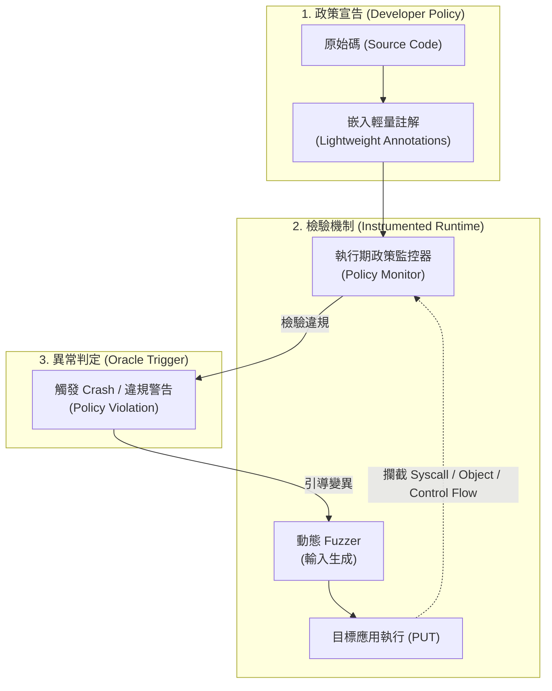

# ANOTA 論文核心技術解讀與架構剖析

> **論文原題**：*Anota: Identifying Business Logic Vulnerabilities via Annotation-Based Sanitization*  
> **發表會議**：Network and Distributed System Security Symposium (**NDSS 2026**)  
> **論文出處**：DOI: `10.14722/ndss.2026.240938` | 本地存檔：`code-security-research/2026-f938-paper.pdf`  
> **作者團隊**：Meng Wang (CISPA), Philipp Görz (CISPA), Joschua Schilling (CISPA), Keno Hassler (CISPA), Liwei Guo (UESTC), Thorsten Holz (MPI-SP), Ali Abbasi (CISPA)  
> **研究機構**：CISPA Helmholtz Center for Information Security, Max Planck Institute for Security and Privacy, 電子科技大學

---

## 📌 執行摘要 (Executive Summary)

模糊測試（Fuzzing）是目前發掘軟體漏洞最普及的動態分析技術，但其有效性高度依賴**消毒器（Sanitizer）**。在傳統記憶體安全領域，AddressSanitizer (ASan) 透過回報非法記憶體存取，將隱蔽缺陷轉化為即時的崩潰訊號（Crash Oracle）。然而，在**業務邏輯漏洞（Business Logic Vulnerabilities）**中，程式不違背語法規範、不產生記憶體崩潰，Fuzzer 無法辨識特定輸入是否觸發了越權或邏輯繞過（即 Test Oracle 難題）。現有啟發式靜態規則面對多變的業務語意往往過度脆弱或產生大量誤報。

發表於資安頂會 NDSS 2026 的 **ANOTA** 提出了一個創新的「人在迴路（Human-in-the-Loop）」消毒器架構。其核心遵循系統設計經典的**「機制與政策分離原則（Separating Policy from Mechanism）」**：
1. **政策層（Policy）**：提供直觀輕量化的**註解系統（Annotation System）**，讓開發者或分析師在原始碼中直接標記業務安全意圖。
2. **機制層（Mechanism）**：由語言無關的**執行期政策監控器（Runtime Policy Monitor）**攔截系統底層行為，當執行偏離註解政策時即向 Fuzzer 回報 Crash 訊號。

---

## 🎯 核心問題定義：CWE Top 40 中的業務邏輯盲區

論文針對 MITRE CWE Top 40 進行全景分析，指出傳統 Fuzzing Sanitizer 面臨嚴重的偵測盲區：
* **已充分解決弱點（Narrowly-Addressed）**：如 SQLi (CWE-89)、XSS (CWE-79)、OS Command Injection (CWE-78)，具有通用的污點匯聚點（Sink）或語法特徵。
* **未獲解決弱點（Unaddressed Business Logic Weaknesses）**：
  * **CWE-862** (Missing Authorization / 缺少授權)
  * **CWE-863** (Incorrect Authorization / 不正確授權)
  * **CWE-287** (Improper Authentication / 認證不當)
  * **CWE-269** (Improper Privilege Management / 特權管理不當)
  * **CWE-200** (Exposure of Sensitive Information / 敏感資訊洩漏)
這些弱點必須具備應用程式的「業務上下文（Application Context）」才能判定合法與否，無法依賴通用啟發式規則自動推導。

---

## 🛠️ ANOTA 註解語法體系 (Annotation System)

ANOTA 將業務邏輯偏差行為歸納為 4 大執行期異常型態，並提供直觀的註解語法（Table II）：

| 異常類別 | 核心意圖說明 | 註解語法範例 | 實際防護情境 |
| :--- | :--- | :--- | :--- |
| **System Call** | 限制特定檔案系統與行程呼叫 | `SYSCALL.BLOCK('execv', 'execve')` `SYSCALL.READ.BLOCK(PATH='/etc/')` `SYSCALL.EXECVE.ALLOW(PATH='/bin/ls')` | 防止目錄遍歷越界讀取、非預期系統命令調用 |
| **Data Flow** | 追蹤資料流傳播與脫敏 | `TAINT(pwd, sanitization=[hash], Sink=[print])` | 確保密碼、Token 必須經過雜湊脫敏後才能印出或回傳 |
| **Object Access** | 限制關鍵變數/函式的存取權與時間 | `WATCH.ALLOW(admin_data, 'r')` `WATCH.BLOCK(admin_api, 'x')` `WATCH.CON(passwd_cmp)` | 阻擋未授權主體讀取敏感物件；強制常數時間比較防側信道 |
| **Code Execution** | 限制特定控制流路徑的執行條件 | `EXECUTION.BLOCK(user.type != 'admin')` | 確保非管理員絕對不可抵達特權執行區塊（BOLA/垂直越權） |
| **Clear** | 動態清除/重設局部作用域政策 | `CLEAR(...)` `SYSCALL.NETWORK.CLEAR()` | 在合法業務切換階段釋放特定限制 |

---

## ⚙️ 執行期監控器機制 (Runtime Policy Monitor)

1. **插樁與攔截（Instrumentation & Interception）**：
   * 在目標程式載入時解析註解，轉換為記憶體中的政策結構。
   * 插樁 policy-relevant 點位（如系統呼叫閘道、變數讀寫位址、函式進入點）。
2. **即時環境評估（Runtime Context Evaluation）**：
   * 當程式抵達插樁點，Monitor 攔截執行並獲取執行期上下文（當前 Session 狀態、堆疊幀變數、傳入參數值）。
   * 比對政策：例如當進入特權 API 時，若 Context 中的 `user.type` 評估結果非 `'admin'`，立即判定違規。
3. **無縫對接 Fuzzer**：
   * 將業務邏輯違規包裝為 Exit Signal / Segmentation Fault 級別的終止事件，使任何標準黑/灰箱 Fuzzer（AFL++、WebFuzz 等）均能立即感知漏洞被觸發，記錄產生該狀態的 Payload。

---

## 📊 實驗設計與關鍵成效 (Evaluation & Results)

### 1. 評測目標與環境
* 結合主流 Fuzzer（ANOTA + FUZZER），評測真實開源 Web 應用程式與框架（如 Home Assistant、PyGoat、OWASP Vulnerable Flask App 等）。

### 2. 漏洞挖掘與重現成效
* **已知漏洞重現（Reproduction）**：成功重現 **43 個**已公開的複雜業務邏輯與授權相關真實漏洞。
* **全新零日漏洞發掘（0-Day Discovery）**：在受測的實際生產專案中，挖掘出 **22 個先前未知的全新漏洞**。
* **CVE 認證**：已獲官方指派頒發 **17 個全新 CVE**（充分驗證其在工業界軟體的威脅發現能力）。

---

## ⚠️ 論文作者坦承的局限與未來方向 (Section VII.C)

在論文第 14-15 頁的討論章節中，作者客觀指出 ANOTA 面臨的根本局限：
1. **依賴昂貴的人工手動成本（Manual Effort）**：
   * 註解必須由深諳業務邏輯的專業人員手動審閱程式碼並撰寫，在大型複雜專案或仰賴第三方黑箱庫時，人工標註成本極高。
2. **專家知識依賴度高（Human Expertise Dependency）**：
   * 標註品質完全取決於審查員的經驗，若標註不完整或標註錯誤，Monitor 將無法檢出漏洞或產生反效果。
3. **作者展望：引入 LLM 進行政策自動化**：
   * 作者明確提出：*「未來的解決方案是結合 LLM 來半自動/自動化推導安全註解。ANOTA 建立了這套政策表達框架，作為將開發者隱含知識轉換為機器可驗證政策的必要第一步，為未來基於 LLM 的可靠自動化研究鋪路。」*
