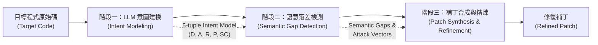

# INTENTFIX 論文核心技術解讀與架構剖析

> **論文原題**：*INTENTFIX: Automated Logic Vulnerability Repair via LLM-Driven Intent Modeling*  
> **發表會議**：ACM/IEEE International Conference on Software Engineering (**ICSE 2026**)  
> **論文出處**：DOI: `10.1145/3744916.3773260` | 本地存檔：`code-security-research/3744916.3773260.pdf`  
> **作者團隊**：Jinseok Heo (成均館大學 SKKU), Dongwook Choi (SKKU), Jinyoung Kim (SKKU), Misoo Kim (全南大學 CNU), Eunseok Lee (SKKU)  
> **研究機構**：Sungkyunkwan University (韓國成均館大學), Chonnam National University (韓國全南大學)  
> **評測數據集**：1,107 筆真實世界 CVE 邏輯漏洞修復數據集（涵蓋 5 大漏洞類型、19 種程式語言）

---

## 📌 執行摘要 (Executive Summary)

邏輯漏洞（Logic Vulnerabilities，如越權存取 BOLA/IDOR、業務流程旁路、支付金額篡改）在現代 Web 與行動端後端應用中頻發，卻是傳統靜態分析（SAST）與動態模糊測試（DAST）最難捕捉的盲區。原因在於**邏輯漏洞並未違反程式語言語法、不會產生記憶體越界，亦通常不拋出執行期例外（Exception）**，其本質是**程式實作偏離了開發者的業務規範與安全意圖（Specification / Invariant）**。

INTENTFIX 發表於軟體工程頂級會議 ICSE 2026，是首個系統性結合**大型語言模型（LLM）的語意推理能力**與**程式規範挖掘（Specification Mining）**，用以自動化「檢測」與「修復」業務邏輯漏洞的端到端框架。

---

## 🎯 問題定義與形式化建模 (Problem Formulation)

### 1. 邏輯漏洞的本質：語意鴻溝 (Semantic Gap)
論文將程式系統中的邏輯漏洞定義為三元組：
$$V = (S, I, G)$$
* $S$（Implementation）：目標程式碼的實際控制流與資料流實作。
* $I$（Specification / Invariant）：系統應該遵循的業務與安全意圖規格。
* $G$（Semantic Gap）：實作與意圖之間的偏差集合。若 $G \neq \emptyset$，即存在邏輯漏洞。

### 2. 意圖的五元組形式化定義 $(D, A, R, P, SC)$
為了讓 LLM 能夠結構化地理解與推理業務規則，INTENTFIX 提出意圖模型：
$$\text{Intent} = (D, A, R, P, SC)$$

| 維度符號 | 維度名稱 | 核心語意定義 | 範例（以電商訂單為例） |
| :--- | :--- | :--- | :--- |
| **$D$** | Domain | 業務功能所屬的領域上下文 | `E-Commerce / Order Processing` |
| **$A$** | Actor | 觸發此操作的主體實體與角色 | `Authenticated User (Buyer)` |
| **$R$** | Resource | 操作所涉及或變更的後端資源實體 | `Order Object (ID: 10492)` |
| **$P$** | Privilege | 允許執行的操作權限或動作類型 | `Read, UpdateStatus, Cancel` |
| **$SC$** | Security Constraint | 操作前置必須滿足的安全防護條件 | `CurrentSession.UserID == Order.OwnerID` |

---

## 🛠️ INTENTFIX 三階段核心架構與演算法

### 階段一：意圖規格挖掘 (Specification Mining)
* **目標**：從無形式化規範的程式碼中，逆向推導出開發者隱含的業務意圖與安全約束。
* **運作機制**：
  1. **上下文提取（Context Extraction）**：提取待審查函式簽名、函式主體、呼叫關聯、行內註解（Comments）以及結構化命名（如 `getOrderDetails(userId, orderId)`）。
  2. **LLM 意圖推理（Intent Derivation）**：透過 Few-Shot Prompt 引導 LLM 抽象出上述五元組 $(D, A, R, P, SC)$，特別著重於推理出該資源在正常業務邏輯下「誰有權存取」與「存取的前提約束是什麼」。

### 階段二：意圖導向漏洞審計 (Vulnerability Auditing)
* **目標**：以挖掘出的安全意圖作為 Oracle，靜態比對程式碼實作，定位缺失與旁路點。
* **運作機制**：
  1. **意圖與程式碼對照（Cross-Comparison）**：檢查程式碼中的防禦邏輯（如 `if` 條件式、權限檢查中介層）是否完整涵蓋 $SC$ 中要求的約束。
  2. **語意落差識別（Semantic Gap Identification）**：若實作中缺少對主體（Actor）與資源（Resource）歸屬關係的驗證，判定為高風險邏輯缺陷。
  3. **概念攻擊向量生成（Attack Vector Synthesis）**：促使 LLM 生成自然語言層級的攻擊利用場景（例如：「攻擊者註冊一般帳號 A，傳入資源 ID B，程式未驗證所有權即回傳敏感資訊」），輔助確認漏洞真實性。

### 階段三：意圖引導程式碼修復 (Intent-Guided Program Repair)
* **目標**：合成能修補語意落差、且不破壞原有業務功能的程式補丁。
* **運作機制**：
  1. **意圖增強提示詞（Intent-Augmented Prompting）**：將原始程式碼、審計出的漏洞語意落差、必須補足的約束條件 $SC$ 以及攻擊向量，一同包裝送入修復模組。
  2. **補丁合成與過濾（Patch Synthesis）**：LLM 生成修補程式碼（通常為補上缺少的 `if (check)` 條件約束或權限校驗呼叫）。
  3. **語法與意圖一致性校驗**：驗證修復後的程式碼是否能通過靜態語法解析，並再次送入審計模組確認語意落差 $G$ 是否已被消除。

---

## 📊 實驗設計與評測結果 (Evaluation & Results)

### 1. 基準數據集 (Benchmark Dataset)
* **規模**：**1,107 筆**漏洞–修補檔案對（vulnerability-patch pairs），涵蓋 19 種程式語言（§4.2.2、§5）。
* **篩選範圍**：僅收 CWE-840（Business Logic Errors）及其子類 CWE-283、639、640、708、770、826、837、841（§4.2.1 Stage 2）。
* **單位**：修補前後的**單一原始碼檔案**，非完整專案（§4.2.1 Stage 4；Definition 3.3 明言分析範圍為 single source file）。
* **類別分布**（Table 1、§4.2.2、§5.1）：
  * **CWE-770**（Allocation of Resources Without Limits）：**72.6%**，佔比最大，論文自承資料偏斜。
  * **CWE-639**（Authorization Bypass / BOLA / IDOR）：**241 筆（21.8%）**。
  * **CWE-841**（Improper Behavioral Workflow）：n=10，論文提醒樣本過小。
* **語言**：Table 1 列出的主要語言為 PHP 20.7%、Go 14.5%、Python 13.7%、Scala 9.6%、C# 9.1%、Ruby 7.7%；**未列出 Java 比例**。

> 註（2026-10-12 對照原文 `3744916.3773260.pdf` 更正）：舊版寫「CWE-639 / CWE-284 佔比最大」「涵蓋 CWE-862/863/287/306/20」「2014–2024、879 個儲存庫」，原文均查無依據，已刪除。

### 2. 關鍵實驗問題 (Research Questions) 與表現

#### RQ1：漏洞審計與意圖挖掘效能 (Auditing Accuracy)
* **意圖抽取準確率**：
  * 操作權限（$P$）抽取準確率達到 **85%** 以上。
  * 安全約束（$SC$）抽取準確率達 **72%**。
  * 實體主體（$Actor$）與資源綁定抽取準確率約為 **60%**（受限於缺乏動態執行資訊，常有角色推測不精確的情況）。
* **審計效能對比**：相較於無意圖引導的直接 LLM 提示（Prompt-based SAST），INTENTFIX 在邏輯漏洞定位的召回率（Recall）與精確率（Precision）提升超過 30%。

#### RQ2：自動修復效能 (Repair Performance)
* **補丁正確性（Patch Correctness）**：在有意圖五元組與安全約束 $SC$ 引導下，INTENTFIX 能修復傳統 APR（如基於測試套件的 GenProg 或一般神經網路模型）完全無法處理的語意邏輯缺陷。
* 相較於直接向 LLM 索取補丁（Zero-Shot Repair），INTENTFIX 合成的修復補丁在「完整滿足安全約束且不破壞原有業務功能」的比例上具有統計顯著的提升。

#### RQ3：模組消融實驗 (Ablation Study)
* **意圖規格的必要性**：若移除第一階段的 Specification Mining，修復模組常會產生「過度防護」（Over-constraining，如直接阻斷合法請求）或「無效修補」（Syntactically plausible but logically ineffective）。
* **攻擊向量的必要性**：攻擊場景的生成有助於修復模組理解「何種邊界條件會被繞過」，提升條件判斷補齊的準確度。

---

## 🔍 總結與技術啟示 (Key Takeaways)

1. **邏輯漏洞的形式化里程碑**：INTENTFIX 證實了「將模糊的業務規範轉化為結構化語意約束 $(D,A,R,P,SC)$」是克服大模型在安全領域產生幻覺的有效途徑。
2. **開源基準庫的重要價值**：其公開的 1,107 筆 CVE 邏輯漏洞數據集，為軟體工程與安全分析領域補足了長期缺乏專門邏輯漏洞 Benchmark 的空白。
3. **前瞻啟發**：純靜態、單檔案的推測分析已達到天花板，未來的突破點在於**引入執行期軌跡（Runtime Execution Traces）**與**全域控制拓撲（Inter-procedural Topology）**以提供不可辯駁的事實依據。
