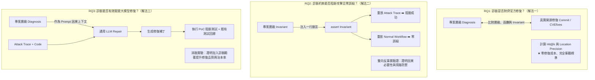

# 業務邏輯漏洞診斷研究（第二年題目討論與文獻梳理）

> **整理說明**：本文件記錄業務邏輯漏洞全生命週期計畫之「第二年（Y2）：根因分析與架構強制機制定位」的完整設計，包含研究定位、文獻邊界、評估方案（解法一、二、三）與實驗規劃。

---

## 1. 研究定位與範圍界定

### 1.1 整體 Pipeline 與第二年切入點
目前的研究階段位於 **「已取得成功攻擊軌跡（PoC/Attack Trace）」之後** 到 **「自動修復（Repair）」之前** 的 **「分析／診斷（Analysis / Diagnosis）」中間層**。

```
[既有輸入（第一年成果）]
- 正常 Workflow (Expected Workflow)
- 已成功的 Attack Trace / PoC (Observed Exploit)
- 後端原始碼 (Backend Source Code)
- 執行期證據 (Runtime Evidence)
       ↓
[第二年研究核心：Analysis / Diagnosis] 🚀
產生足以供後續修復使用的 Project-level Enforcement Diagnosis
       ↓
[後續階段（第三年工作）：Repair]
自動產生 Patch 與跨區塊修復驗證
```

### 1.2 明確排除的非研究方向（不是第二年的工作）
1. **找正常 Workflow**：已作為既有輸入，不需重新推導。
2. **發現漏洞 (Discovery)**：Attack Trace 已客觀證明漏洞存在，不需要重新探測。
3. **單純對比流程差異**：若僅輸出「攻擊者跳過了付款步驟」，這在 Attack Trace 輸入中已經得知，不具研究貢獻。
4. **單純錯誤定位 (Fault Localization / Line Ranking)**：計算 Top-k 嫌疑行號或切片（Slicing）本質上只是相關性排序，無法解釋業務邏輯架構上的缺失。
5. **直接產生 Patch**：修補屬於後續 Repair 階段的工作。

---

## 2. 核心研究問題：專案層級強制機制診斷 (Enforcement Diagnosis)

### 2.1 問題陳述
> **已知一個業務邏輯／工作流漏洞（Business/Workflow Vulnerability）確實可被 Exploit，如何從外部可觀測的違規行為與執行證據，推導出後端實作機制為何允許該行為發生，並產生足以支撐後續修復的「專案層級診斷（Project-level Diagnosis）」？**

### 2.2 具體案例對比

* **輸入情境**：
  * **預期流程**：`Create` $\to$ `Pay` $\to$ `Approve` $\to$ `Ship`
  * **攻擊軌跡**：`Create` $\to$ `Ship` $\to$ `Success`

* **無效診斷（低價值／重述現象）**：
  > 「攻擊者繞過了 Pay 與 Approve。」（輸入已有，無實作層洞察）

* **有價值的專案層級診斷（Enforcement Diagnosis）**：
  > 1. `/ship` 這條進入路徑（Entry Path）未執行正常流程中要求的前置條件強制檢查（Prerequisite Enforcement）。
  > 2. 狀態檢查只被實作在特定的 UI/API Handler，而真正執行狀態變更（State Mutation）的 Domain/Service Layer 並未維護該 invariant（不變量）。
  > 3. 系統中存在其他 Callers 亦可抵達相同 Mutation，因此不能簡化為單一 Endpoint 的 Bug。

### 2.3 核心因果分析鏈
$$\text{Behavioral Violation} \longrightarrow \text{Implementation Mechanism} \longrightarrow \text{Missing/Inconsistent Enforcement} \longrightarrow \text{Repair-Relevant Context}$$

---

### 2.4 目標弱點分類界定（9 個核心 CWE 與 4 大分類）
依據計畫綱要，本研究以 **CWE-840 (Business Logic Errors)** 為核心，依攻擊者破壞的物件將業務邏輯弱點劃分為四大類別：

| 弱點類別 | 目標 CWE | 弱點定義與破壞行為 | 對應 OWASP API 2023 |
| :--- | :--- | :--- | :--- |
| **流程型 (Workflow)** | **CWE-841**<br>**CWE-837**<br>**CWE-799** | • 未正確執行行為流程限制（跳步、亂序）<br>• 未正確限制單次且唯一的操作（重複送出）<br>• 未適當限制操作互動頻率（高頻濫用） | API6 (Unrestricted Access to Sensitive Business Flows)<br>API4 (Unrestricted Resource Consumption) |
| **授權型 (Authorization)** | **CWE-639**<br>**CWE-862**<br>**CWE-863** | • 透過使用者可控識別碼繞過授權 (BOLA/IDOR)<br>• 缺少授權檢查<br>• 授權檢查不正確（碰到不該碰的資源） | API1 (Broken Object Level Authorization)<br>API5 (Broken Function Level Authorization) |
| **參數／商業規則型 (Parameter / Business Rules)** | **CWE-1284**<br>**CWE-472** | • 未正確驗證輸入數量是否符合業務規則<br>• 外部可控制假定不可變的 Web 參數（竄改價格/金額） | API3 (Broken Object Property Level Authorization) |
| **前後端信任 (Client-Server Trust)** | **CWE-602** | • 安全檢查放錯位置（僅在客戶端/App 檢查，後端放行） | 跨類別架構缺陷 |

---

### 2.5 不變量形式化界定與失效雙型態（Invariants & Failure Modes）
業務邏輯漏洞本質上發生在 **「功能不變量」與「安全不變量」之間的落差**：

```
【功能不變量 Functional Invariant】（必須成功）
合法 Actor · 合法 Evidence · 合法路徑  ==>  Action 必須成功、Business State 正確轉移
（現況：App/前端的正常業務流程自然滿足）

【安全不變量 Security Invariant】（不得生效）
任何 Actor · 任何輸入 · 缺少 Evidence  ==>  Action 不得生效
（現況：必須由 Server 後端強制執行；App 端檢查可被輕易繞過）
```

後端 **強制判斷式（Enforcement Predicate）** 存在兩種經典失效型態：
1. **缺失型（Missing Predicate）**：該有的檢查根本不存在（如 Nextcloud CVE-2026-45810 未檢查留言屬於哪個檔案）。
2. **未採用型（Ineffective Check）**：檢查邏輯有執行，但判定結果未被採用，或存入無人讀取的欄位（如 J2Store CVE-2026-77999 查證結果存進未讀取變數）。

---

### 2.6 Y2 核心輸出物規範：漏洞根因 ＋ 函式路徑風險矩陣
第二年的白箱分析並非只輸出單一行號，而是輸出：
1. **漏洞根因（Root Cause Predicate）**：精確描述缺失的 Invariant 條件式與應強制執行的層級（Service / Domain）。
2. **函式路徑風險矩陣（Function Path Risk Matrix）**：利用 Call Graph / 拓撲圖結構，分析並標記系統中所有**共享同一業務 Invariant 的其他進入點與路徑（Shared Sinks / Entrypoints）**，直接為 Y3 的 Multi-Hunk 修補提供修補位置與優先順序。

---

## 3. 文獻現況與 Novelty（新意）邊界分析

### 3.1 現有文獻支撐基礎
* **MITRE CWE-841 (Improper Enforcement of Behavioral Workflow)**：官方明確指出業務邏輯類型的弱點分類仍處於研究不足（Understudied）的狀態，證明此領域並非已解決的老問題。
* **Waler**：能從正常的執行過程中推導潛在的業務規則。
* **DetLogic**：將預期行為建立為狀態機（FSM），進而導出約束規則。
* **LoopRepair**：利用 Proof-of-Vulnerability (PoV) 與執行軌跡（Execution Trace）改善自動修復，並獲得頂會最佳論文獎。
* **INTENTFIX (ICSE 2026)**：
  * *論文全名*：《Fixing Logic Vulnerabilities via LLM-Driven Specification Mining and Repair》
  * *核心方法*：將邏輯漏洞定義為「開發者意圖（Developer Intent）」與「實作（Implementation）」之間的落差。流程為：形式化意圖 $\to$ 比對差距 $\to$ 實施修復。
  * 📑 **專題對標分析三部曲**：
    1. [INTENTFIX_論文核心技術解讀.md](./INTENTFIX_論文核心技術解讀.md)：客觀解構論文背景、$(D,A,R,P,SC)$ 意圖模型、三階段演算法與 1,107 筆 CVE 評測成效。
    2. [INTENTFIX_論文價值與參考借鑑.md](./INTENTFIX_論文價值與參考借鑑.md)：提煉可借鑑之資料集資產、消融實驗設計與意圖形式化規範。
    3. [INTENTFIX_對標局限與Y2核心創新點.md](./INTENTFIX_對標局限與Y2核心創新點.md)：剖析 INTENTFIX 純靜態與單檔案局限，確立場景中 Y2 獨立的「路徑還原、失效判定、拓撲風險矩陣與斷言探針」核心創新點。

### 3.2 不可宣稱的無效 Novelty（已被做過）
* ❌ 不能宣稱「沒有人研究 Workflow」。
* ❌ 不能宣稱「沒有人從意圖回推實作落差（Intent-Implementation Gap）」。
* ❌ 不能宣稱「沒有人利用 Exploit / PoC Trace 輔助修復」。

### 3.3 潛在的新意空間
* **組合特殊性**：以「已知正常流程」＋「已知成功攻擊軌跡」＋「原始碼／Runtime 證據」為輸入，**不做 Discovery 也不直接做 Repair**，專門研究如何產生**獨立可客觀查核的 Enforcement Diagnosis**。
* **需驗證的假設**：加入成功的攻擊軌跡後，診斷結果是否真的比「僅依賴 Workflow ＋ 原始碼（如 INTENTFIX 風格）」更準確、更完整？若無顯著優勢，價值將被既有研究覆蓋。

---

## 4. 關鍵爭議：獨立論文下的驗證困境與破解

在討論過程中，曾一度陷入「若第二年不包含修復（Repair），且傳統修復模組無法輸入自訂診斷，則獨立論文根本無法驗證」的困境。

經過文獻與方法論梳理，學界在頂會（ICSE / FSE / ISSTA / USENIX Security）對於「純診斷／Root Cause Analysis」早已具備成熟的驗證範式，**完全不需要自己造修復輪子，也不會落入循環論證**。

---

## 5. 獨立論文評估方案（解法一、二、三之文獻與資料集）

### 5.1 解法一：真實開源修復 Commit 對齊（Developer Ground Truth）
> **核心概念**：論文屬於 Root Cause Analysis (RCA) 領域，**真實世界開發者的修復 Commit / Pull Request 就是客觀的 Gold Standard**。完全不需跑自動修復，純粹評估診斷的精準度。

#### 權威資料集與 Benchmark
1. **CVEfixes / Big-Vul / Vul4J**：
   * 軟體安全界權威的漏洞修復資料集。收錄 BOLA、權限繞過、商業邏輯缺陷，每筆漏洞均精確綁定 GitHub 官方修復 Commit Hash、修改前後的 Code Diff (AST) 及 CVE Advisory。
2. **SWE-bench**：
   * 軟體工程界權威基準集，以真實 GitHub Issue 與官方合入的修復 PR 作為標準。
3. **RCAEval / OpenRCA / RCABench**：
   * 專門評估根因分析（RCA）技術的標準 Benchmark，內含真實故障軌跡（Logs/Traces）與官方標註的真因 Commit，專門評估不含修復的純診斷演算法。

#### 客觀量化評估指標（零修復成本）
* **Coarse-grained Layer Accuracy（架構層級命中率）**：
  * 診斷建議修在 Domain/Service Layer，而開發者 Commit 也確實改在 Service Layer（而非 Controller），即算命中。
* **Fine-grained Hit@k（Method / Class 命中率）**：
  * 診斷輸出的候選修復 Method/Function Top-1 或 Top-3 是否涵蓋官方 Commit 修改的函數。
* **Missing Invariant Match（語意與約束對齊）**：
  * 比對官方 Commit 補上的防禦條件式（如 `if (!order.isApproved())`）與系統診斷出的 Invariant 邏輯是否等價（利用 AST 或 Reasoning-level Match）。只要因果解釋與官方 Patch Diff 對齊，即客觀判定為 True Positive (TP)。

#### 5.1.1 本計畫雙核心真實案例研究（Benchmark Anchor Cases）

##### 案例一：J2Store 假冒付款通知（CVE-2026-77999，CVSS 8.7 High）
* **弱點類型**：CWE-602（前後端信任）＋ CWE-472（參數型）
* **官方修補基準**：Joomla 電商擴充 `payment_paypal.php`，官方 Commit `58dd786`
* **根因機制與 Multi-Hunk 分佈**：
  1. `_validateIPN()`（L951, 962–967）：CURL 啟用 SSL 憑證驗證，且**只接受 VERIFIED**（拒絕 UNVERIFIED 亦被當成通過）。
  2. `_process()`（L995–1001）：將驗證錯誤 `$errorV` 正式賦值給 `$error` 往下游傳遞（**修復 Ineffective Check**：原代碼將驗證結果存入無人讀取的陣列，導致失敗結果被忽略）。
  3. `_processSale()`（L1170–1171）：強制檢查 `$mc_gross` 欄位必須存在且大於 0（防禦不帶金額欄位時跳過金額比對）。
* **診斷價值**：若診斷只指出單一 hunk（如只修查證或只修金額），攻擊者依然能繞過。系統必須輸出涵蓋上述檢查鏈的專案層級約束。

##### 案例二：Nextcloud 留言跨檔案越權存取（CVE-2026-45810，CVSS 6.8 Medium）
* **弱點類型**：CWE-639（授權型 BOLA / IDOR）
* **官方修補基準**：Nextcloud Server `apps/dav/lib/Comments/EntityCollection.php`，官方 PR `#56982`
* **根因機制與同源入口分佈**：
  1. `getChild()`（L77–80，讀取入口 N1）：增加歸屬檢查 `if ($comment->getObjectId() !== $this->id) throw new NotFound();`。
  2. `childExists()`（L131–134，存在檢查同源入口 N2）：同步增加同一條歸屬檢查 `$comment->getObjectId() === $this->id`。
* **診斷價值**：若只在 `getChild()` 補上防禦，攻擊者依然可透過 `childExists()` 探測任意留言 ID 是否存在。**診斷引擎必須識別此兩個進入點共享同一個安全不變量（Shared Invariant）**，指導修復者同步修復。

---

### 5.2 解法二：Assertion 因果反事實驗證（Causal Invariant Verification via Assertion Injection）
> **核心概念**：論文屬於 Invariant Specification 與 Security Oracle 領域。**完全不寫修補程式碼**，而是將診斷推導出的缺失約束轉化為一行「防禦斷言（Security Assertion / Guard Clause）」，直接注入指定層級的函數入口，透過程式動態執行的「雙向反事實驗證」證明診斷的因果有效性。

#### 頂會最新代表性文獻
1. **《STARS: Static Analysis-guided Assertion Synthesis》** (ISSTA 2026/2024)：
   * 利用靜態分析引導 LLM 自動合成程式不變量斷言（Invariant Assertions），將其作為程式安全防禦與規範驗證依據。
2. **《Counterfactual Fault Localization》** 系列研究 (ISSTA / FSE)：
   * 透過反事實干預（Intervention）驗證因果推論——在診斷定位處插入約束，觀察執行結果是否產生反轉（攻擊被攔截、正常行為不受損）。
3. **《TOGA / TOGLL / SecMutBench》** (ICSE 2022 / 2025, AIware 2026)：
   * 確立「測試預言生成（Test Oracle Generation）」與「語意層擊殺（Semantic Kill）」的評測標準，證實斷言攔截足以作為衡量漏洞是否被有效防禦的客觀黃金指標。

#### 實驗設計協議（Assertion Injection Protocol）
```python
# 系統根據 Diagnosis 自動在 Domain/Service 層入口注入一行防禦斷言
assert order.status == Status.APPROVED, "Security Invariant Violation"
```
執行全自動動態驗證，無需人工介入：
1. **攻擊阻斷驗證（Soundness / Exploit Interception）**：重放 Attack Trace / PoC，檢驗執行是否必定觸發該斷言並被安全攔截。
2. **正常功能無損驗證（Completeness / Benign Preservation）**：重放專案既有的全部 Unit Tests 與正常 Workflow，檢驗是否 100% 順暢通過（零誤殺，False Alarm = 0）。
3. **旁路防禦完整性驗證（Bypass Resilience / Architectural Coverage）**：測試系統中抵達相同 State Mutation 的其他進入點路徑，驗證 Service 層斷言是否能一舉防護所有進入點（直接證明專案架構診斷相較於單一 API Endpoint 修補的優越性）。

---

### 5.3 解法三：以通用 LLM 為修復載體之消融實驗（Causal-Guided Repair）
> **核心概念**：現代 APR 工具主流已全面轉向通用大模型（Claude、GPT、DeepSeek）。**LLM 天生具備通用文本輸入接口，可直接吃進結構化診斷報告**。無需開發複雜修復模組，僅需撰寫輕量腳本執行消融實驗。

#### 頂會最新代表性文獻
1. **《CausalRepair: Automated Program Repair via Dual-Slicing》** (2025/2026 前沿 APR 工作)：
   * **核心痛點**：指出現有 LLM-based APR 面臨嚴重的 **「因果缺口（Causality Gap）」**——因為 LLM 僅看到表層錯誤日誌，缺乏因果上下文，容易產生幻覺補丁或治標不治本。
   * **解決與評估方法**：CausalRepair 透過分析提煉出「最小因果上下文（Minimal Causal Context / 診斷報告）」，直接 Prompt 餵給現成模型（DeepSeek、GPT），在 Defects4J 上修復成功率顯著超越 SOTA。
2. **《AutoCodeRover: Autonomous Program Improvement》** (ISSTA 2024)：
   * 透過分析層萃取結構化上下文與定位診斷，直接 Prompt 餵給 LLM 生成 Patch，消融實驗證實精確診斷能使 LLM 修復率倍增。
3. **《ChatRepair》** (ICSE 2024 / TOSEM)：
   * 證實向 LLM 提供結構化的錯誤原因解釋（Bug Explanation）能顯著降低補丁過擬合（Overfitting）與回歸錯誤。

#### 實驗設計協議（Ablation Protocol）
只需設計一組標準消融實驗，對比有無診斷對修復品質的影響：
* **組別 A（Vanilla Baseline）**：`[原始碼 + Attack Trace]` $\longrightarrow$ 輸入通用 LLM $\longrightarrow$ 生成 Patch A（多為治標補丁）。
* **組別 B（Ours 診斷增強）**：`[原始碼 + Attack Trace + 專案層級診斷報告]` $\longrightarrow$ 輸入同一個 LLM $\longrightarrow$ 生成 Patch B（架構層級治本補丁）。

#### 客觀驗證指標（測試套件自動評估）
1. **Exploit Invalidation Rate（漏洞阻斷率）**：Patch 是否成功讓攻擊者的 PoC 執行失敗。
2. **Regression-Free Pass Rate（回歸通過率）**：Patch 是否 100% 通過專案既有的所有單元／整合測試。
3. **Architectural vs. Superficial Fix（治本 vs. 治標比例）**：統計補丁修復在 Service/Domain 根因層級 vs. 僅在 Controller 擋請求的比例。

---

## 6. 三大解法綜合對照與 Evaluation 章節規劃

### 6.1 三大評估途徑對照表

| 評估途徑 | 評估本質 | 操作方式 | 是否需寫修復模組？ | 客觀評判依據 |
| :--- | :--- | :--- | :---: | :--- |
| **解法一：Commit 對齊** | **靜態準確性** | 比對官方 CVE Git Diff | ❌ 否 | 位置命中率 (Hit@k)、約束 AST 相似度 |
| **解法二：Assertion 注入** | **動態因果性** | 注入 1 行斷言重放 Trace | ❌ 否 | 攻擊阻斷率、既有測試通過率、旁路防禦率 |
| **解法三：LLM 消融** | **下游實用性** | 診斷當 Prompt 丟給 LLM | ❌ 否（調現成 API） | 有診斷 vs 無診斷的補丁治本率躍升 |

---

### 6.2 第二年論文標準 Evaluation 章節規劃（三維閉環）



* **RQ1（靜態準確性 - Intrinsic Alignment）**：在公開漏洞庫（如 CVEfixes、Vul4J）上，證明診斷結果與真實資深工程師的修復 Commit 具備高度一致性（位置與約束重合度）。
* **RQ2（動態因果性 - Causal Verification）**：透過極簡 Assertion 注入，證明推導出的 Invariant 能 100% 阻斷 PoC 攻擊、0% 破壞既有正常功能，並在架構層級堵死所有多進入點旁路。
* **RQ3（下游實用性 - Extrinsic Utility）**：在消融實驗中，證明本系統產出的診斷能作為即插即用（Plug-and-Play）的最小因果上下文，顯著提升現今主流 LLM 修補業務邏輯漏洞的治本率與正確率。

---

## 7. 後續具體執行步驟

1. **資料集準備**：從 CVEfixes / Vul4J 或專案既有漏洞案例庫中，篩選出 20–30 個具備明確修復 Commit 的業務邏輯／BOLA 漏洞。
2. **診斷引擎實作**：聚焦由 PoC Trace + Workflow 推導出 Enforcement Diagnosis 的分析演算法。
3. **實驗腳本編寫**：
   * 撰寫 Git Diff 比對腳本（計算 RQ1 的 Layer/Method Hit@k）。
   * 撰寫 30 行調用 LLM API 的 Prompting 腳本與測試自動運行腳本（驗證 RQ2 的修復消融）。
