# Y2 文獻三大梯隊盤點與精準實作收斂報告

> **報告定位**：三年期計畫「第二年（Y2 侑宸：白箱根因分析、不變量診斷、執行軌跡對齊與風險拓撲矩陣）」  
> **盤點初衷**：全面審視已檢索之 12 篇頂會標竿文獻，**無情區分「實作核心」與「背景修辭」**，杜絕研究虛胖與焦點發散，確立 Y2 真正需要寫程式實作的演算法核心。

---

## 📌 執行摘要：第二年的核心身分與任務邊界

在進入文獻盤點前，必須再次嚴格錨定第二年（Y2 侑宸）的**不可替代身分**：

* ❌ **Y2 不是 Y1**：Y2 **不做模糊測試（No Fuzzing）也不做黑箱探索（No Discovery）**。Y2 的輸入是 Y1 已經打穿的動態 Exploit 封包與呼叫日誌（漏洞存在是已知事實）。
* ❌ **Y2 不是 Y3**：Y2 **不做代碼修復（No Patch Repair）**。修碼是第三年（Y3 羿君）的職責。
* ✅ **Y2 的真正身分是「犯罪現場鑑識官（Post-Exploit Forensic RCA）」**：
  1. **Trace-to-Path 對齊**：將 HTTP 封包映射至 Controller $\to$ Service $\to$ DAO 呼叫鏈。
  2. **判斷式失效模式雙軌診斷**：精確判定是 `Missing Predicate`（缺少檢查）還是 `Ineffective Check`（檢查邏輯無效/被旁路）。
  3. **因果斷言探針（Assertion Probe）**：注入 1 行探針，驗證「阻斷攻擊 ＋ 放行正常」。
  4. **函式路徑風險矩陣（Risk Matrix）**：沿 Call Graph 反向可達性搜尋所有未檢查進入點。

---

## 🛑 十二篇頂會文獻之三大梯隊無情分流

經嚴格審視，目前文獻庫收錄的 12 篇文獻對 Y2 的重要性絕非「平起平坐」，而是呈現極其明確的三大梯隊：

```mermaid
flowchart TD
    subgraph 梯隊一 ["【第一梯隊：第二年的核心命根子】(實作非它不可 · 佔 50% 精力)"]
        direction TB
        C1["1. CRIX (USENIX Sec '19) ── Peer Slices 抓 Missing Predicate 的理論骨架"]
        C2["2. PeX (USENIX Sec '19) ── 沿呼叫圖反向找未防護進入點 (Risk Matrix 算法核心)"]
        C3["3. BolaRay (ACM CCS '24) ── 101 個真實 BOLA 與資料庫實體授權模型 (Y2 攻擊靶心)"]
        C4["4. INTENTFIX (ICSE '26) ── 1,107 筆邏輯漏洞數據集 ＋ 唯一頭號對標物"]
        C5["5. Predicate Switching (ICSE '06) ── 動態條件反轉 (斷言探針因果驗證原型)"]
        C6["6. CVEfixes (PROMISE '21) ── 官方修復 Commit Diff (RQ1 評測標準答案庫)"]
    end

    subgraph 梯隊二 ["【第二梯隊：借皮不借骨】(動機背書與語法標準 · 計畫書軍火庫)"]
        direction TB
        S1["7. ANOTA (NDSS '26) ── 借其 Table II 探針語法標準；以 Sec VII.C 為 Proposal 動機"]
        S2["8. Waler (USENIX Sec '10) ── 經典老祖宗，向委員證明 Invariant 挖掘的正統性"]
        S3["9. ACMiner (CODASPY '19) ── 關聯規則挖權限，證明策略挖掘在安全界被認可"]
    end

    subgraph 梯隊三 ["【第三梯隊：修辭支撐與防禦性引用】(純吵架武器 · 絕不投入實作精力)"]
        direction TB
        P1["10. LoopRepair (ICSE '26) ── 🚨 實為 Y3 (APR)，做 C/C++ 記憶體修復！(純修辭證明定位價值)"]
        P2["11. TOGLL (ICSE '25) ── 🚨 實為單元測試生成，僅用來證明 LLM 能寫 assert！"]
        P3["12. CodeX (CODASPY '25) ── 🚨 實為 Chrome 擴充套件分析，僅供 CodeQL 查詢語法參考！"]
    end
```

---

### 一、第一梯隊：第二年「真正要寫進演算法、非它不可」的 6 篇

這 6 篇是第二年（Y2 侑宸）**真正要做、要寫 code 實作的技術靈魂**：

| 論文名稱與頂會 | 論文核心技術 | 對 Y2 侑宸的「直接實作依賴」 |
| :--- | :--- | :--- |
| **1. [CRIX (USENIX Security 2019)](file:///c:/Users/LabStrix/Documents/GitHub/Youchen/Security/code-security-research/research-vault/notes/CRIX%20(2019)%20Detecting%20Missing-Check%20Bugs%20via%20Semantic-%20and%20Context-Aware%20Criticalness%20and%20Constraints%20Inferences.md)** | **同儕切片（Peer Slices）**跨路徑比對條件約束 | **演算法核心**：Y2 判定 **`Missing Predicate`** 的理論支柱。進入點 A 有做身份驗證，但進入點 B 存取同實體卻跳過了 $\to$ 判定 B 缺失檢查。 |
| **2. [PeX (USENIX Security 2019)](file:///c:/Users/LabStrix/Documents/GitHub/Youchen/Security/code-security-research/research-vault/notes/PeX%20(2019)%20A%20Permission%20Check%20Analysis%20Framework%20for%20Linux%20Kernel.md)** | 跨程序 CFG 路徑遍歷，全域搜尋繞過檢查路徑 | **演算法核心**：Y2 **「函式路徑風險矩陣（Risk Matrix）」**的圖遍歷算法骨架。由被攻擊的 Sink 沿呼叫圖逆流而上，搜尋全專案共享該約束的所有路徑。 |
| **3. [BolaRay (ACM CCS 2024)](file:///c:/Users/LabStrix/Documents/GitHub/Youchen/Security/code-security-research/research-vault/notes/BolaRay%20(2024)%20Detecting%20Broken%20Object-Level%20Authorization%20Vulnerabilities%20in%20Database-Backed%20Applications.md)** | 101 個真實 BOLA 實證與 4 類資料庫授權模型 | **領域字典**：BOLA（CWE-639）到底長什麼樣？BolaRay 定義了資料庫 ORM 外鍵與物件所有權的 4 大模式，是 Y2 定義安全約束的實體字典。 |
| **4. [INTENTFIX (ICSE 2026)](file:///c:/Users/LabStrix/Documents/GitHub/Youchen/Security/code-security-research/research-vault/notes/IntentFix%20(2026)%20Automated%20Logic%20Vulnerability%20Repair%20via%20LLM-Driven%20Intent%20Modeling.md)** | 五元組意圖規格 $(D, A, R, P, SC)$ ＋ 1,107 筆 CVE | **對標與實驗庫**：Y2 的頭號對標論文。其開源的 1,107 筆真實 CVE（含 241 筆 BOLA）是 Y2 大規模實證實驗不可或缺的資料來源。 |
| **5. [Predicate Switching (ICSE 2006)](file:///c:/Users/LabStrix/Documents/GitHub/Youchen/Security/code-security-research/research-vault/notes/Predicate%20Switching%20(2006)%20Locating%20Faults%20through%20Automated%20Predicate%20Switching.md)** | 失敗重播中強制切換條件分支（True/False） | **因果驗證核心**：Y2 在不修碼的前提下，如何證明這個 Predicate 是根因？借鑑其條件反轉邏輯，驗證探針能否精確阻斷攻擊。 |
| **6. [CVEfixes (PROMISE 2021 / MSR)](file:///c:/Users/LabStrix/Documents/GitHub/Youchen/Security/code-security-research/research-vault/notes/CVEfixes%20(2021)%20Automated%20Collection%20of%20Vulnerabilities%20and%20Their%20Fixes%20from%20Open-Source%20Software.md)** | Commit 級別官方修復前後 Diff 數據庫 | **評測標準答案**：Y2 RQ1 評測「根因診斷是否與官方開發者修復對齊」時的客觀 Ground Truth。 |

---

### 二、第二梯隊：第二年的「動機背書與語法標準」（借皮不借骨）

這 3 篇**不是 Y2 要去實作的技術**，但寫計畫書或應對委員時**能派上大用場**：

* **[ANOTA (NDSS 2026)](file:///c:/Users/LabStrix/Documents/GitHub/Youchen/Security/code-security-research/research-vault/notes/Anota%20(2026)%20Identifying%20Business%20Logic%20Vulnerabilities%20via%20Annotation-Based%20Sanitization.md)**：
  * **真相**：它本質是做 Fuzzing Sanitizer，屬於第一年（Y1）的測試 Oracle 範疇。
  * **Y2 為什麼留它？**：
    1. **借語法標準**：直接借用它的 Table II 四大類原語（`EXECUTION.BLOCK`, `WATCH`, `TAINT`），讓 Y2 的探針具備頂會背書的語法標準。
    2. **借研究動機**：作者在 Section VII.C 親口承認「人工手動標註太昂貴，留給未來用 LLM 自動化」。這段話是 Y2 Proposal 最強大的立論武器！
* **[Waler (USENIX Security 2010)](file:///c:/Users/LabStrix/Documents/GitHub/Youchen/Security/code-security-research/research-vault/notes/Waler%20(2010)%20Toward%20Automated%20Detection%20of%20Logic%20Vulnerabilities%20in%20Web%20Applications.md) & [ACMiner (CODASPY 2019)](file:///c:/Users/LabStrix/Documents/GitHub/Youchen/Security/code-security-research/research-vault/notes/ACMiner%20(2019)%20Extraction%20and%20Analysis%20of%20Authorization%20Checks%20in%20Android%20Middleware.md)**：
  * **用途**：寫 Proposal 第 1 章「國內外現況（Related Work）」，向審查委員展示該領域過去十餘年的演進脈絡，證明「不變量規格挖掘」是正規且歷史悠久的學術流派。

---

### 三、第三梯隊：實為「擦邊球」（純修辭與防禦性引用，絕不浪費研發精力）

這 3 篇論文在實作時**請直接放過自己，完全不需要去啃它們的工程細節**：

1. **[LoopRepair (ICSE 2026 傑出論文獎)](file:///c:/Users/LabStrix/Documents/GitHub/Youchen/Security/code-security-research/research-vault/notes/LoopRepair%20(2026)%20Location-Aware%20and%20Trace-Guided%20Iterative%20Automated%20Vulnerability%20Repair.md)**：
   * **大實話**：**它本質上是第三年（Y3 程式修復 APR）的論文！** 而且它做的是 C/C++ 記憶體溢位，不是 Web/微服務業務邏輯！
   * **唯一用途**：當有外行委員質疑「為什麼不直接叫 LLM 修 code，還要你第二年定位幹嘛？」時，拿這篇 ICSE 傑出論文堵住他的嘴：「頂會最佳論文已證明，沒有做好 Location-aware Trace 定位，直接修 code 根本修不好！」（純修辭武器）。
2. **[TOGLL (ICSE 2025)](file:///c:/Users/LabStrix/Documents/GitHub/Youchen/Security/code-security-research/research-vault/notes/TOGLL%20(2025)%20Correct%20and%20Strong%20Test%20Oracle%20Generation%20with%20LLMs.md)**：
   * **大實話**：做的是 Java 單元測試斷言生成（Unit Testing），不是資安漏洞診斷。僅用來證明「LLM 寫 assert 在學界是被認可的」。
3. **[CodeX (ACM CODASPY 2025)](file:///c:/Users/LabStrix/Documents/GitHub/Youchen/Security/code-security-research/research-vault/notes/CodeX%20(2025)%20Contextual%20Flow%20Tracking%20for%20Privacy%20in%20Browser%20Extensions.md)**：
   * **大實話**：分析的是 Chrome 瀏覽器外掛，跟後端微服務關聯較遠。僅作為未來實作 CodeQL 查詢時的語法手冊參考。

---

## 🎯 結論：給侑宸的研發實作定心丸

這次盤點最重要的收穫就是**「幫第二年大幅減負、聚焦作戰」**：

* 💡 **不要被 12 篇甚至未來的數百篇嚇到**：您真正需要動手寫演算法實作的，**只有第一梯隊的那 6 篇（核心圍繞 CRIX、PeX、BolaRay、INTENTFIX）**。
* 💡 **演算法管線收斂為 4 步走**：
  1. **輸入**：接收 Y1 動態 Exploit 封包 $\to$ 呼叫鏈對齊。
  2. **診斷**：參考 **BolaRay** 模型 ＋ **CRIX** 同儕切片，標記 `Missing Predicate` vs. `Ineffective Check`。
  3. **拓撲**：參考 **PeX** 反向可達性算法，輸出 **函式路徑風險矩陣（Risk Matrix）**。
  4. **驗證**：參考 **Predicate Switching** ＋ **ANOTA Table II**，注入 1 行探針雙向重播驗證因果必要性。
* 💡 其餘的論文，都是替我們的 Proposal 與論文穿上的「學術防彈衣」，讓審查委員挑不出任何毛病！
