# Y2 文獻三大梯隊盤點與精準實作收斂報告（第二版：純血 Web/API 換血升級）

> **報告定位**：三年期計畫「第二年（Y2 侑宸：白箱根因分析、不變量診斷、執行軌跡對齊與風險拓撲矩陣）」  
> **盤點初衷**：全面審視已檢索文獻，**無情淘汰與 Web 後端弱相關的通用系統/內核論文（如 Linux Kernel、Chrome 外掛）**，引進 2025/2026 IEEE S&P 與 ACM CCS **真正專攻 Web/API 業務邏輯、BOLA、水平越權與 Missing-Owner-Check 的頂會標竿神作**，確立 Y2 真正需要寫程式實作的演算法核心！

---

## 📌 執行摘要：第二年的核心身分與任務邊界

在進入文獻盤點前，必須再次嚴格錨定第二年（Y2 侑宸）的**不可替代身分**：

* ❌ **Y2 不是 Y1**：Y2 **不做模糊測試（No Fuzzing）也不做黑箱探索（No Discovery）**。Y2 的輸入是 Y1 已經打穿的動態 Exploit 封包與呼叫日誌（漏洞存在是已知事實）。
* ❌ **Y2 不是 Y3**：Y2 **不做代碼修復（No Patch Repair）**。修碼是第三年（Y3 羿君）的職責。
* ✅ **Y2 的真正身分是「犯罪現場鑑識官（Post-Exploit Forensic RCA）」**：
  1. **Trace-to-Path 對齊**：將 HTTP 封包映射至 Controller $\to$ Service $\to$ DAO 呼叫鏈。
  2. **判斷式失效模式雙軌診斷**：精確判定是 `Missing Predicate`（缺少檢查）還是 `Ineffective Check`（檢查邏輯無效/被旁路）。
  3. **因果斷言探針（Assertion Probe）**：注入 1 行探針，驗證「阻斷攻擊 ＋ 放行正常」。
  4. **函式路徑風險矩陣（Risk Matrix）**：沿 Call Graph 反向可達性搜尋所有未檢查進入點。

---

## 🛑 文獻三大梯隊無情分流（純血 Web 邏輯漏洞版）

經過第二輪深度檢索與嚴格求證，我們全面升級了文獻庫，徹底排除了系統底層（Kernel C 語言）的干擾，換上純正血統的 **Web / API / Java 後端邏輯漏洞頂會文獻**：

```mermaid
flowchart TD
    subgraph 梯隊一 ["【第一梯隊：第二年的核心命根子】(Web/API 純血實作 · 佔 50% 精力)"]
        direction TB
        C1["1. MocGuard (IEEE S&P '25) ── 👑 核心骨架！Java Web 專屬 Missing-Owner-Check 資料庫跨層分析"]
        C2["2. BolaRay (ACM CCS '24) ── 101 個真實 BOLA 與 4 類資料庫授權模型字典 (Y2 靶心)"]
        C3["3. MACE (ACM CCS '14) ── 授權上下文一致性 (Web 端水平越權跨端點比對鼻祖)"]
        C4["4. INTENTFIX (ICSE '26) ── 1,107 筆邏輯漏洞 CVE 庫 ＋ 唯一頭號對標物"]
        C5["5. IDORacle (2026) ── Controller 與 SQL-Sink 斷層架構論述 ＋ 所有權謂詞探針注入語意"]
        C6["6. Predicate Switching (ICSE '06) ── 動態條件反轉 (斷言探針因果反事實驗證原型)"]
        C7["7. CVEfixes (PROMISE '21) ── 官方修復 Commit Diff (RQ1 評測標準答案庫)"]
    end

    subgraph 梯隊二 ["【第二梯隊：借皮不借骨】(動機背書、無規格推導與語法標準)"]
        direction TB
        S1["8. RoleCast (OOPSLA '11) ── 軟工經典！證明『在完全沒有安全規格下』能靠角色模式找 Missing Check"]
        S2["9. ANOTA (NDSS '26) ── 借其 Table II 探針語法標準；以 Sec VII.C 為 Proposal 動機"]
        S3["10. Waler (USENIX Sec '10) ── Web Invariant 老祖宗，向委員證明業務邏輯約束挖掘的正統性"]
        S4["11. CRIX (USENIX Sec '19) ── Peer Slices 概念借用 (提供跨路徑比對的泛化論述)"]
    end

    subgraph 梯隊三 ["【第三梯隊：修辭支撐與防禦性引用】(純吵架武器 · 絕不投入實作精力)"]
        direction TB
        P1["12. LoopRepair (ICSE '26) ── 🚨 實為 Y3 (APR)，做 C/C++ 記憶體修復！(純修辭證明定位價值)"]
        P2["13. TOGLL (ICSE '25) ── 🚨 實為單元測試生成，僅用來證明 LLM 能寫 assert！"]
        P3["14. PeX (USENIX Sec '19) ── 🚨 實為 Linux Kernel，僅保留呼叫圖逆流遍歷之演算法比對！"]
    end
```



---

### 一、第一梯隊：第二年「真正要寫進演算法、非它不可」的 7 篇

這 7 篇是第二年（Y2 侑宸）**真正要做、要寫 code 實作的技術靈魂**（全部針對 Web、API 與資料庫後端）：

| 論文名稱與頂會 | 論文核心技術 | 對 Y2 侑宸的「直接實作依賴」 |
| :--- | :--- | :--- |
| **1. [MocGuard (IEEE S&P 2025)](file:///c:/Users/LabStrix/Documents/GitHub/Youchen/Security/code-security-research/research-vault/notes/MocGuard%20(2025)%20Automatically%20Detecting%20Missing-Owner-Check%20Vulnerabilities%20in%20Java%20Web%20Applications.md)** | **Java Web 專屬 Missing-Owner-Check**，資料庫為中心跨 Java 與 SQL 雙層分析 | **👑 演算法核心範本**：直接取代傳統 Kernel 模型！針對 Java 後端（Spring/MyBatis），分析從 Controller 入口到資料庫 SQL 查詢之間**遺漏使用者擁有權檢查（MOC）**的關鍵路徑。 |
| **2. [BolaRay (ACM CCS 2024)](file:///c:/Users/LabStrix/Documents/GitHub/Youchen/Security/code-security-research/research-vault/notes/BolaRay%20(2024)%20Detecting%20Broken%20Object-Level%20Authorization%20Vulnerabilities%20in%20Database-Backed%20Applications.md)** | 101 個真實 BOLA 實證與 4 類資料庫授權模型 | **領域字典**：BOLA（CWE-639）到底長什麼樣？BolaRay 定義了資料庫 ORM 外鍵與物件所有權的 4 大模式，是 Y2 定義安全約束的實體字典。 |
| **3. [MACE (ACM CCS 2014)](file:///c:/Users/LabStrix/Documents/GitHub/Youchen/Security/code-security-research/research-vault/notes/MACE%20(2014)%20Detecting%20Privilege%20Escalation%20Vulnerabilities%20in%20Web%20Applications.md)** | **授權上下文一致性（Authorization Context Consistency）**，跨端點比對 | **演算法核心**：Web 水平越權（HPE）的頂會開山！進入點 A 有對資源檢查身份，但進入點 B 卻漏掉了 $\to$ 跨端點一致性比對找出 Missing Check。 |
| **4. [INTENTFIX (ICSE 2026)](file:///c:/Users/LabStrix/Documents/GitHub/Youchen/Security/code-security-research/research-vault/notes/IntentFix%20(2026)%20Automated%20Logic%20Vulnerability%20Repair%20via%20LLM-Driven%20Intent%20Modeling.md)** | 五元組意圖規格 $(D, A, R, P, SC)$ ＋ 1,107 筆 CVE | **對標與實驗庫**：Y2 的頭號對標論文。其開源的 1,107 筆真實 CVE（含 241 筆 BOLA）是 Y2 大規模實證實驗不可或缺的資料來源。 |
| **5. [IDORacle (2026)](file:///c:/Users/LabStrix/Documents/GitHub/Youchen/Security/code-security-research/research-vault/notes/IDORacle%20(2026)%20Template-Guided%20SQL-Sink%20Mediation%20for%20Object-Level%20Authorization%20in%20Java%20Applications.md)** | Controller 與 SQL-Sink 架構斷層，所有權謂詞注入 | **架構論述與探針語意**：解釋「為什麼檢查做在 Controller 會漏、應該在何處強制」。為 Y2 的因果斷言探針（Assertion Probe）提供最標準的謂詞格式。 |
| **6. [Predicate Switching (ICSE 2006)](file:///c:/Users/LabStrix/Documents/GitHub/Youchen/Security/code-security-research/research-vault/notes/Predicate%20Switching%20(2006)%20Locating%20Faults%20through%20Automated%20Predicate%20Switching.md)** | 失敗重播中強制切換條件分支（True/False） | **因果驗證核心**：Y2 在不修碼的前提下，如何證明這個 Predicate 是根因？借鑑其條件反轉邏輯，驗證探針能否精確阻斷攻擊。 |
| **7. [CVEfixes (PROMISE 2021 / MSR)](file:///c:/Users/LabStrix/Documents/GitHub/Youchen/Security/code-security-research/research-vault/notes/CVEfixes%20(2021)%20Automated%20Collection%20of%20Vulnerabilities%20and%20Their%20Fixes%20from%20Open-Source%20Software.md)** | Commit 級別官方修復前後 Diff 數據庫 | **評測標準答案**：Y2 RQ1 評測「根因診斷是否與官方開發者修復對齊」時的客觀 Ground Truth。 |

---

### 二、第二梯隊：第二年的「動機背書、無規格推導與語法標準」（借皮不借骨）

這 4 篇**不是 Y2 要去實作的技術**，但寫計畫書或應對委員質詢時**能派上關鍵用場**：

* **[RoleCast (OOPSLA 2011)](file:///c:/Users/LabStrix/Documents/GitHub/Youchen/Security/code-security-research/research-vault/notes/RoleCast%20(2011)%20Finding%20Missing%20Security%20Checks%20When%20You%20Do%20Not%20Know%20What%20Checks%20Are.md)**：
  * **用途**：委員常問：「開發者又沒寫安全規範，你怎麼知道哪裡少檢查了？」拿出 RoleCast 回答：「軟工頂會 OOPSLA 經典文獻早已證實，可利用系統角色結構與關鍵變數一致性，在零規格下自動推導缺失檢查！」
* **[ANOTA (NDSS 2026)](file:///c:/Users/LabStrix/Documents/GitHub/Youchen/Security/code-security-research/research-vault/notes/Anota%20(2026)%20Identifying%20Business%20Logic%20Vulnerabilities%20via%20Annotation-Based%20Sanitization.md)**：
  * **借語法標準**：直接借用其 Table II 四大類原語（`EXECUTION.BLOCK`, `WATCH`, `TAINT`），讓 Y2 探針語法具備頂會背書。
  * **借研究動機**：作者在 Section VII.C 親口承認「人工手動標註太昂貴，留給未來用 LLM 自動化」，這是 Y2 Proposal 最強大的立論背書。
* **[Waler (USENIX Security 2010)](file:///c:/Users/LabStrix/Documents/GitHub/Youchen/Security/code-security-research/research-vault/notes/Waler%20(2010)%20Toward%20Automated%20Detection%20of%20Logic%20Vulnerabilities%20in%20Web%20Applications.md)**：
  * **用途**：證明 Web 不變量（Invariant）挖掘是安全頂會正統流派。
* **[CRIX (USENIX Security 2019)](file:///c:/Users/LabStrix/Documents/GitHub/Youchen/Security/code-security-research/research-vault/notes/CRIX%20(2019)%20Detecting%20Missing-Check%20Bugs%20via%20Semantic-%20and%20Context-Aware%20Criticalness%20and%20Constraints%20Inferences.md)**：
  * **用途**：提供「同儕切片（Peer Slices）」形式化定義的廣義學術引用。

---

### 三、第三梯隊：實為「擦邊球」（純修辭與防禦性引用，絕不浪費研發精力）

這 3 篇論文在實作時**請直接放過自己，完全不需要去啃它們的工程細節**：

1. **[LoopRepair (ICSE 2026 傑出論文獎)](file:///c:/Users/LabStrix/Documents/GitHub/Youchen/Security/code-security-research/research-vault/notes/LoopRepair%20(2026)%20Location-Aware%20and%20Trace-Guided%20Iterative%20Automated%20Vulnerability%20Repair.md)**：
   * **大實話**：**它本質上是第三年（Y3 程式修復 APR）的論文！** 而且它做的是 C/C++ 記憶體溢位，不是 Web 業務邏輯！
   * **唯一用途**：堵住委員質疑為什麼第二年不直接叫 LLM 修碼，證明「缺乏精確 Trace 定位，直接修復必敗」。
2. **[TOGLL (ICSE 2025)](file:///c:/Users/LabStrix/Documents/GitHub/Youchen/Security/code-security-research/research-vault/notes/TOGLL%20(2025)%20Correct%20and%20Strong%20Test%20Oracle%20Generation%20with%20LLMs.md)**：
   * **大實話**：做的是 Java 單元測試斷言生成（Unit Testing），僅用來證明「LLM 寫 assert 是可行的」。
3. **[PeX (USENIX Security 2019)](file:///c:/Users/LabStrix/Documents/GitHub/Youchen/Security/code-security-research/research-vault/notes/PeX%20(2019)%20A%20Permission%20Check%20Analysis%20Framework%20for%20Linux%20Kernel.md)**：
   * **大實話**：做的是 Linux Kernel C 語言驅動。**其實作已被 MocGuard (IEEE S&P 2025) 完美取代**，僅在圖演算法上作為相關工作被動提及。

---

## 🎯 結論：換血升級後的 Y2 研發路徑

這次「純血 Web 邏輯漏洞文獻換血」讓 Y2 侑宸的研究拼圖變得極其清晰、完全接地氣：

```
[第一年輸出：HTTP Exploit Trace]
          │
          ▼
【步驟 1：Trace-to-Path 映射】(MocGuard 跨層映射模型)
將攻擊請求對齊至 Controller ➡️ Service ➡️ DAO / SQL-Sink 呼叫路徑
          │
          ▼
【步驟 2：判斷式失效模式雙軌診斷】(MocGuard MOC + MACE 一致性 + BolaRay 模型)
- 對比正常同儕端點 (Peer Endpoints)
- 比對資料庫外鍵/擁有權關係
- 精確判定是 Missing Predicate 還是 Ineffective Check
          │
          ▼
【步驟 3：路徑風險拓撲矩陣】(MocGuard + MACE 跨程序呼叫圖遍歷)
由被攻擊的持久化 Sink 沿呼叫圖逆流而上，搜尋全專案共享該約束的所有危險進入點
          │
          ▼
【步驟 4：反事實因果斷言探針驗證】(IDORacle 謂詞語意 + Predicate Switching 反轉)
注入 1 行 Invariant 斷言探針，驗證：
1. 重放 Attack Trace ➡️ 100% 成功阻斷 (True Positive)
2. 重放 Normal Workflow ➡️ 0% 誤殺正常流程 (False Positive = 0)
```

**結論**：第二年的所有演算法全部立足於 **IEEE S&P 2025 (MocGuard)**、**ACM CCS 2024 (BolaRay)**、**ACM CCS 2014 (MACE)**、**ICSE 2026 (INTENTFIX)** 與 **2026 (IDORacle)**。不僅純度 100% 是 Web 後端，而且具備頂會最高級別的技術硬度！
