# Y2 文獻三大梯隊盤點與實作收斂報告（第二版）

> **報告定位**：三年期計畫「第二年（Y2 侑宸：白箱根因分析、不變量診斷、執行軌跡對齊與風險拓撲矩陣）」
> **盤點目的**：審視已檢索文獻，排除與 Web 後端弱相關的系統／核心類論文，改以專攻 Web/API 業務邏輯、BOLA、水平越權與 Missing-Owner-Check 的文獻為主。
>
> **2026-10-12 修訂**：刪除查無依據或缺乏理由的敘述，核對紀錄見 [討論紀錄 Q16](01-discussion-logs/2026-10-12_Y2流程釐清與風險矩陣設計討論.md)。主要刪改：語言範圍「Java 後端」（無理由）、INTENTFIX 資料集「不可或缺」（與原文不符）、PeX「已被 MocGuard 取代」（無依據）、LoopRepair「傑出論文獎」（查無來源）、步驟 1/3 對 MocGuard、MACE 的方法歸屬（未核對）、步驟 4「100% 阻斷／0% 誤殺」（目標非結果）、精力比例與修辭性評價。

---

## 📌 執行摘要：第二年的核心身分與任務邊界

* ❌ **Y2 不是 Y1**：Y2 **不做模糊測試（No Fuzzing）也不做黑箱探索（No Discovery）**。Y2 的輸入是 Y1 已經打穿的動態 Exploit 封包（漏洞存在是已知事實）；Y1 是否同時提供呼叫日誌，待與祐廷確認。
* ❌ **Y2 不是 Y3**：Y2 **不做代碼修復（No Patch Repair）**。修碼是第三年（Y3 羿君）的職責。
* ✅ **Y2 的身分是「事後根因鑑識（Post-Exploit Forensic RCA）」**：
  1. **Trace-to-Path 對齊**：將 HTTP 封包映射至 入口 $\to$ 業務邏輯 $\to$ 資料存取 呼叫鏈。
  2. **判斷式失效模式雙軌診斷**：判定是 `Missing Predicate`（缺少檢查）還是 `Ineffective Check`（檢查邏輯無效／被旁路）。
  3. **因果斷言探針（Assertion Probe）**：注入 1 行探針，驗證「阻斷攻擊 ＋ 放行正常」。
  4. **函式路徑風險矩陣（Risk Matrix）**：沿 Call Graph 反向可達性搜尋所有未檢查進入點。

---

## 🛑 文獻三大梯隊分流

第二輪檢索後，排除系統底層（Kernel C 語言）文獻，改以 **Web / API 後端邏輯漏洞文獻**為主：

```mermaid
flowchart TD
    subgraph 梯隊一 ["【第一梯隊：Y2 方法設計的主要參考】"]
        direction TB
        C1["1. MocGuard (IEEE S&P '25) ── Java Web Missing-Owner-Check，以資料庫為中心的分析"]
        C2["2. BolaRay (ACM CCS '24) ── 101 個真實 BOLA 實證與 4 類物件層級授權模型"]
        C3["3. MACE (ACM CCS '14) ── 授權上下文一致性，跨進入點比對"]
        C4["4. INTENTFIX (ICSE '26) ── 意圖五元組 (D,A,R,P,SC)；Y2 對標論文"]
        C5["5. IDORacle (2026) ── SQL 層所有權規則攔截（執行期防禦）"]
        C6["6. Predicate Switching (ICSE '06) ── 動態條件反轉（探針因果驗證參考）"]
        C7["7. CVEfixes (PROMISE '21) ── 官方修復 Commit Diff（RQ1 評測參考答案）"]
    end

    subgraph 梯隊二 ["【第二梯隊：動機、無規格推導與語法參考】"]
        direction TB
        S1["8. RoleCast (OOPSLA '11) ── 無安全規格下以角色結構找 Missing Check"]
        S2["9. ANOTA (NDSS '26) ── Table II 註解原語；Sec VI.C 為動機"]
        S3["10. Waler (USENIX Sec '10) ── Web 應用不變量推論"]
        S4["11. CRIX (USENIX Sec '19) ── Peer Slices 概念"]
    end

    subgraph 梯隊三 ["【第三梯隊：相關工作引用，不投入實作】"]
        direction TB
        P1["12. LoopRepair (ICSE '26) ── C/C++ 漏洞修復（APR），與 Y3 較相關"]
        P2["13. TOGLL (ICSE '25) ── 以 LLM 生成單元測試 oracle"]
        P3["14. PeX (USENIX Sec '19) ── Linux Kernel 權限檢查分析"]
    end
```



---

### 一、第一梯隊：Y2 方法設計的主要參考（7 篇）

| 論文名稱與會議 | 論文核心技術 | 對 Y2 的用途 |
| :--- | :--- | :--- |
| **1. [MocGuard (IEEE S&P 2025)](file:///c:/Users/LabStrix/Documents/GitHub/Youchen/Security/code-security-research/research-vault/notes/MocGuard%20(2025)%20Automatically%20Detecting%20Missing-Owner-Check%20Vulnerabilities%20in%20Java%20Web%20Applications.md)** | **Java Web Missing-Owner-Check 偵測**：先分析資料庫結構找出使用者表與使用者擁有的資料，再檢查 Java 程式與 SQL 查詢是否正確執行存取控制 | 擁有權檢查缺失的判定方式參考。MocGuard 為靜態偵測工具，不處理攻擊紀錄 |
| **2. [BolaRay (ACM CCS 2024)](file:///c:/Users/LabStrix/Documents/GitHub/Youchen/Security/code-security-research/research-vault/notes/BolaRay%20(2024)%20Detecting%20Broken%20Object-Level%20Authorization%20Vulnerabilities%20in%20Database-Backed%20Applications.md)** | 101 個真實 BOLA 實證研究，歸納 4 類物件層級授權模型，結合 SQL 分析與靜態分析 | Y2 描述「被違反的授權規則」時的分類參考 |
| **3. [MACE (ACM CCS 2014)](file:///c:/Users/LabStrix/Documents/GitHub/Youchen/Security/code-security-research/research-vault/notes/MACE%20(2014)%20Detecting%20Privilege%20Escalation%20Vulnerabilities%20in%20Web%20Applications.md)** | **授權上下文一致性（Authorization Context Consistency）**：進入點 A 對資源檢查身分、進入點 B 卻沒有 $\to$ 跨進入點比對找出 Missing Check | 同儕比對的方法來源 |
| **4. [INTENTFIX (ICSE 2026)](file:///c:/Users/LabStrix/Documents/GitHub/Youchen/Security/code-security-research/research-vault/notes/IntentFix%20(2026)%20Automated%20Logic%20Vulnerability%20Repair%20via%20LLM-Driven%20Intent%20Modeling.md)** | 意圖五元組 $(D, A, R, P, SC)$；以 LLM 推論意圖、比對程式碼、產生修補。分析範圍為單一原始碼檔案 | **對標論文**。資料集為 1,107 筆單一檔案修補對（CWE-639 佔 241 筆、21.8%；CWE-770 佔 72.6%；主要語言未列 Java），是否適合作為 Y2 評測資料待決定 |
| **5. [IDORacle (2026)](file:///c:/Users/LabStrix/Documents/GitHub/Youchen/Security/code-security-research/research-vault/notes/IDORacle%20(2026)%20Template-Guided%20SQL-Sink%20Mediation%20for%20Object-Level%20Authorization%20in%20Java%20Applications.md)** | 在 MyBatis/JDBC 層攔截 SQL，依所有權規則允許、改寫或阻擋（arXiv 2609.12426；同儕審查版刊於 Computers & Security） | 探針「在 SQL 層檢查所有權」的設計參考。IDORacle 本身是執行期防禦，不是定位工具 |
| **6. [Predicate Switching (ICSE 2006)](file:///c:/Users/LabStrix/Documents/GitHub/Youchen/Security/code-security-research/research-vault/notes/Predicate%20Switching%20(2006)%20Locating%20Faults%20through%20Automated%20Predicate%20Switching.md)** | 失敗重播中強制切換條件分支（True/False） | **因果驗證參考**：Y2 在不修碼的前提下，如何證明這個 Predicate 是根因？借鑑其條件反轉邏輯，驗證探針能否阻斷攻擊 |
| **7. [CVEfixes (PROMISE 2021)](file:///c:/Users/LabStrix/Documents/GitHub/Youchen/Security/code-security-research/research-vault/notes/CVEfixes%20(2021)%20Automated%20Collection%20of%20Vulnerabilities%20and%20Their%20Fixes%20from%20Open-Source%20Software.md)** | Commit 級別官方修復前後 Diff 數據庫 | **評測參考答案**：Y2 RQ1 評測「根因診斷是否與官方開發者修復對齊」 |

---

### 二、第二梯隊：動機、無規格推導與語法參考

這 4 篇**不是 Y2 要實作的技術**，用於計畫書的動機與相關工作：

* **[RoleCast (OOPSLA 2011)](file:///c:/Users/LabStrix/Documents/GitHub/Youchen/Security/code-security-research/research-vault/notes/RoleCast%20(2011)%20Finding%20Missing%20Security%20Checks%20When%20You%20Do%20Not%20Know%20What%20Checks%20Are.md)**：
  * **用途**：回應「開發者沒寫安全規格，怎麼知道哪裡少檢查」—— RoleCast 在無安全規格下，利用角色結構推導缺少的安全檢查。
* **[ANOTA (NDSS 2026)](file:///c:/Users/LabStrix/Documents/GitHub/Youchen/Security/code-security-research/research-vault/notes/Anota%20(2026)%20Identifying%20Business%20Logic%20Vulnerabilities%20via%20Annotation-Based%20Sanitization.md)**：
  * **語法參考**：Table II 的註解原語，涵蓋系統呼叫、資料流、物件存取、程式執行四類（如 `SYSCALL`、`TAINT`、`WATCH`、`EXECUTION.BLOCK`），可作為 Y2 探針語法的參考。
  * **動機**：作者在 Section VI.C（Integrating LLMs）將「以 LLM 輔助產生註解」列為未來工作。
* **[Waler (USENIX Security 2010)](file:///c:/Users/LabStrix/Documents/GitHub/Youchen/Security/code-security-research/research-vault/notes/Waler%20(2010)%20Toward%20Automated%20Detection%20of%20Logic%20Vulnerabilities%20in%20Web%20Applications.md)**：
  * **用途**：Web 應用不變量推論的早期代表作。
* **[CRIX (USENIX Security 2019)](file:///c:/Users/LabStrix/Documents/GitHub/Youchen/Security/code-security-research/research-vault/notes/CRIX%20(2019)%20Detecting%20Missing-Check%20Bugs%20via%20Semantic-%20and%20Context-Aware%20Criticalness%20and%20Constraints%20Inferences.md)**：
  * **用途**：「同儕切片（Peer Slices）」概念的引用來源。

---

### 三、第三梯隊：相關工作引用，不投入實作

1. **[LoopRepair (ICSE 2026)](file:///c:/Users/LabStrix/Documents/GitHub/Youchen/Security/code-security-research/research-vault/notes/LoopRepair%20(2026)%20Location-Aware%20and%20Trace-Guided%20Iterative%20Automated%20Vulnerability%20Repair.md)**：
   * 屬自動程式修復（APR），對象為 C/C++ 漏洞，與 Y3 較相關。
   * **用途**：其方法先提供「應優先修補的位置」再迭代修補，可用來說明定位資訊對修補的作用。
2. **[TOGLL (ICSE 2025)](file:///c:/Users/LabStrix/Documents/GitHub/Youchen/Security/code-security-research/research-vault/notes/TOGLL%20(2025)%20Correct%20and%20Strong%20Test%20Oracle%20Generation%20with%20LLMs.md)**：
   * 以 LLM 生成單元測試 oracle（斷言），僅用來說明 LLM 生成斷言的可行性。
3. **[PeX (USENIX Security 2019)](file:///c:/Users/LabStrix/Documents/GitHub/Youchen/Security/code-security-research/research-vault/notes/PeX%20(2019)%20A%20Permission%20Check%20Analysis%20Framework%20for%20Linux%20Kernel.md)**：
   * Linux Kernel 權限檢查分析，僅在呼叫圖分析上作為相關工作提及。

---

## 🎯 結論：Y2 研發路徑

> 步驟 2 的判斷依據已於 2026-10-12 調整（以被違反的規則為主、同儕比對為輔），現行流程見 [Y2_流程.md](Y2_流程.md)。

```
[第一年輸出：HTTP Exploit Trace]
          │
          ▼
【步驟 1：Trace-to-Path 映射】
將攻擊請求對齊至 入口 ➡️ 業務邏輯 ➡️ 資料存取 / SQL-Sink 呼叫路徑
          │
          ▼
【步驟 2：判斷式失效模式雙軌診斷】(MocGuard MOC + MACE 一致性 + BolaRay 模型)
- 對比正常同儕端點 (Peer Endpoints)
- 比對資料庫外鍵/擁有權關係
- 判定是 Missing Predicate 還是 Ineffective Check
          │
          ▼
【步驟 3：路徑風險拓撲矩陣】
由被攻擊的持久化 Sink 沿呼叫圖逆流而上，搜尋全專案共享該約束的所有危險進入點
          │
          ▼
【步驟 4：反事實因果斷言探針驗證】(IDORacle 所有權規則 + Predicate Switching 反轉)
注入 1 行 Invariant 斷言探針，目標：
1. 重放 Attack Trace ➡️ 攻擊被阻斷
2. 重放 Normal Workflow ➡️ 正常流程不受影響
```
